

  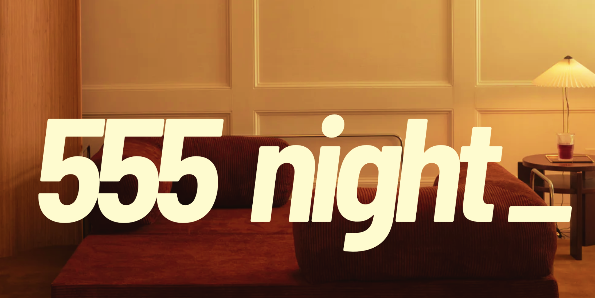

  
<em>For the full experience, play <a href="https://open.spotify.com/track/3YgtkOxZsTuaZdL8McA1FQ?si=352f6c7356834377">adore u by Fred again..</a> while reading this</em>

**Summary**

After returning from Toronto and noticing Montreal's nascent community-building scene, I decided to create something new with a few builder friends. We launched 555 nights - a demo evening with a simple format: 5 slides, 5 minutes, 5 minutes of Q&A.

The concept is straightforward: creators, builders, and curious minds gather in the cozy space of Building 21 to share their passions and projects. Each presenter gets exactly 5 minutes to walk through 5 slides about something they're diving deep into - whether it's a side project, research interest, or creative pursuit. This is followed by 5 minutes of engaging Q&A with the audience.

The format creates a perfect balance - enough time to meaningfully share your work, but brief enough to keep energy high and attention focused. We provided amazing chai and snacks to fuel the conversations.

Check it out here on Luma: [here](https://lu.ma/a9faq740)

**Origin Story**

Thanks for sticking around seems like you have an extra 5 minutes in your day, let me take you through the origin story of 555.

 
**_October 14_**
 

I had been thinking of this idea of doing a presentation night for a while, but decided less overthinking and just execute. If I wanted to create something, I can just go and do it and that's what I set out to do.

On October 14th, I created a groupchat on Instagram with a couple of friends and this was how 555 was born.

  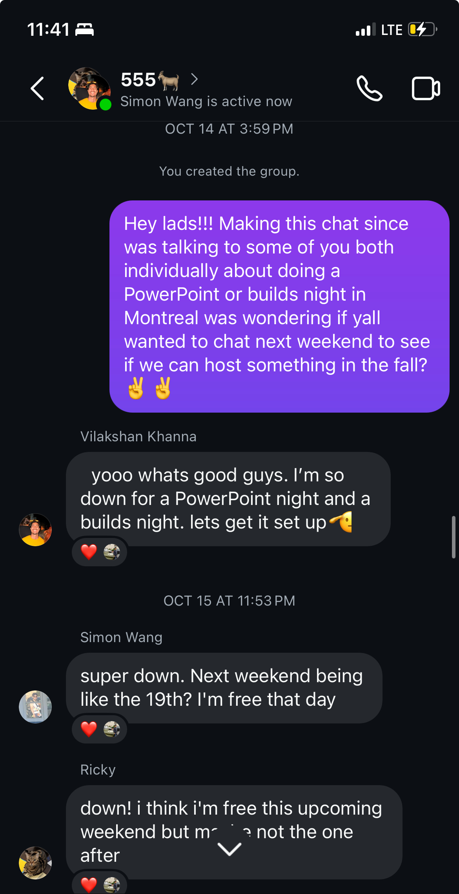
  <em>Starting roster featuring me, Vilakshan, Ricky and Simon</em>

 
**_October 25_**
 

After our initial group chat, we met up at Robotica's Hackerspace to brainstorm and flesh out the concept. The energy was electric - just four people excited about creating something new for Montreal's maker community. We debated formats, venues, and ways to keep it engaging while staying true to the core idea: giving people a platform to share their passions in a structured but casual way. We ultimately chose Building 21 as our venue - a cozy space at McGill perfect for fostering intimate discussions and creative exchanges.

  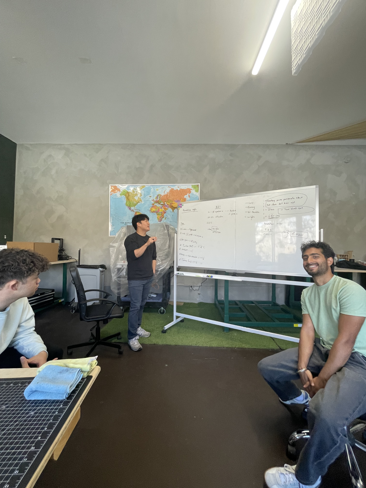
  <em>Brainstorming with the boys at Robotica's Hackerspace in Montreal</em>

 
**_October 26_**
 

The next day, I said "fuck it" - let's test this proof of concept. Sure, something like this would work in Toronto's bustling tech scene, but Montreal? Only one way to find out. I fired off a tweet to gauge interest, curious if anyone would bite...

  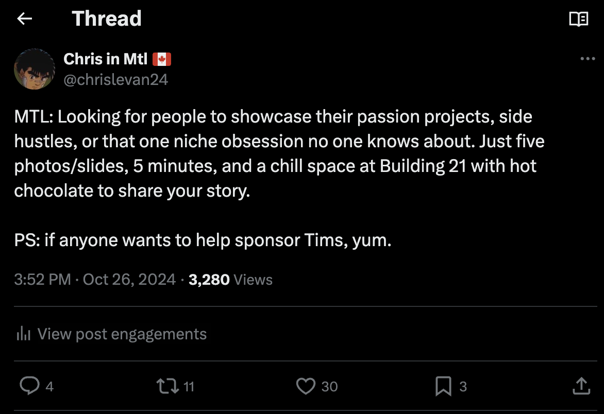
  <em>Testing the waters in Montreal to see if anyone would bite</em>

The response was overwhelming! Within hours, my notifications were blowing up with folks wanting to demo their projects, others excited to watch, and even potential sponsors reaching out. The Montreal community was clearly hungry for something like this.

What really caught me off guard (in the best way) was when S.T. slid into my DMs offering to sponsor the event!

  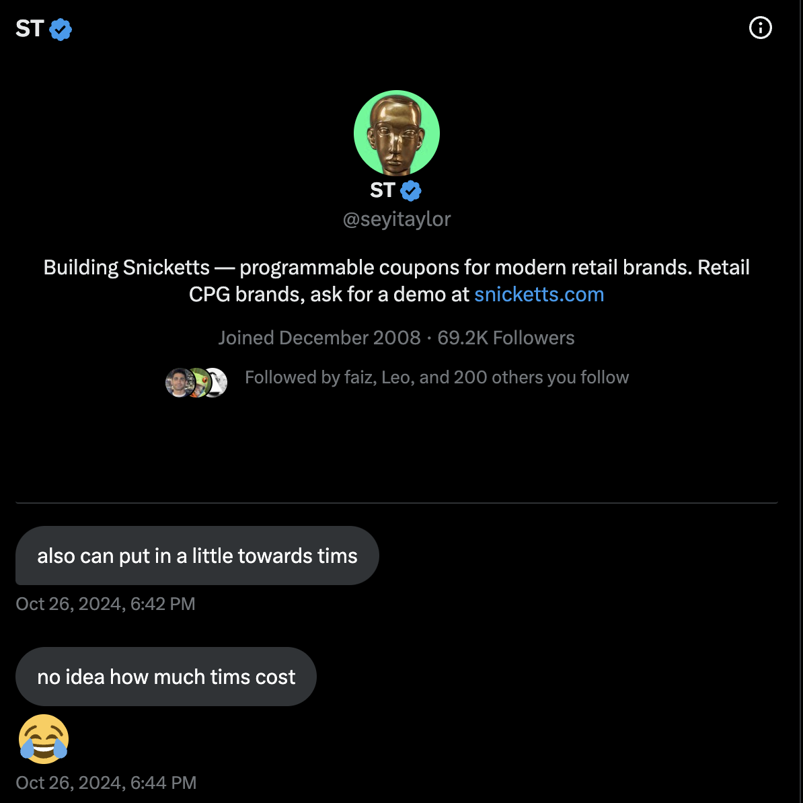
  <em>Had a ton of people in the community message me to demo but also to sponsor shoutout to S.T & Aaron!</em>

 
**_October 28 to November 9_**
 

The next couple weeks were a whirlwind of prep. We had people sliding into our DMs left and right wanting to present - the Twitter thread really took off with folks from all corners of Montreal chiming in.

We wanted to make sure this wasn't just another tech bro meetup, so we went out of our way to invite people from totally different scenes - artists, musicians, you name it. The goal was to mix it up and get some fresh perspectives in the room. Behind the scenes, Vilakshan was going ham on Canva (check out his design process [here](https://www.canva.com/design/DAGUuN8_c8E/g0JBm3yfmQpTyPqe5rBYYA/edit)) Check out a cheeky voice memo on his design process if you're interested:

  <audio controls preload="auto">
    <source src="/assets/555_photos/555_process.mp3" type="audio/mpeg">
    Your browser does not support the audio element.
  </audio>

We hit the ground running with distribution. Our main channel? Twitter. The platform was perfect for what we needed - quick reach, easy sharing, and it let us tap right into Montreal's tech and creative circles. Between the retweets and quote tweets, word spread like wildfire. The momentum was insane - we went from zero to forty-plus signups in under two weeks. wohoooo!

  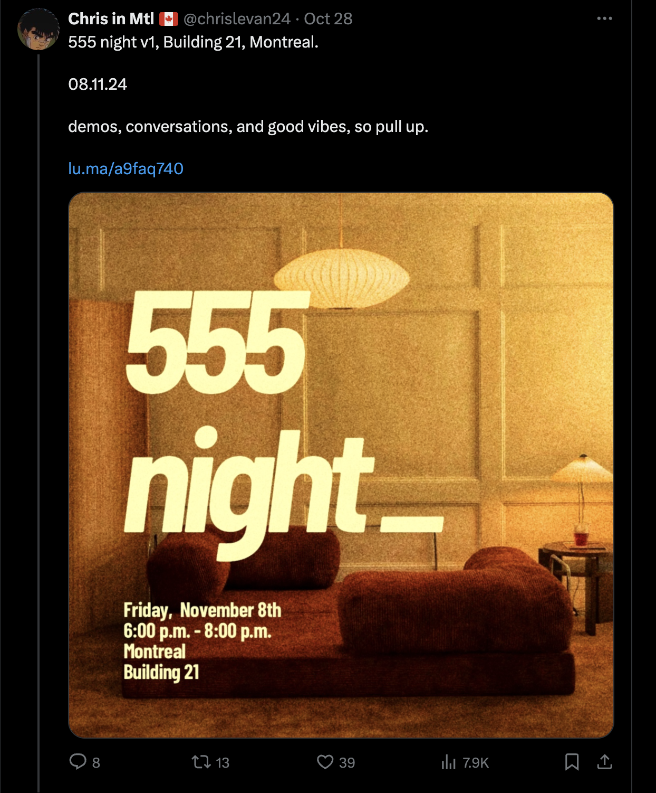
  <em>Vilakshan cheffed up the graphics, Simon got the Luma set up and it was time to distribute!</em>

  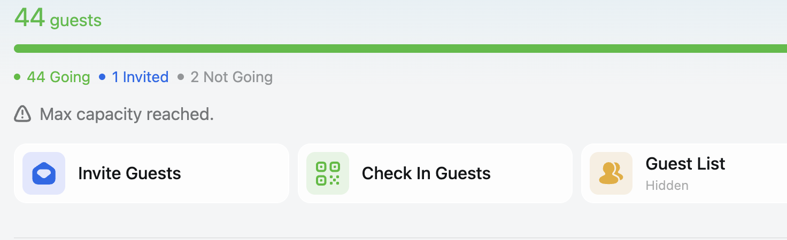
  <em>In less than 2 weeks we reached full capacity at around 40+ people!</em>

Vilakshan was in full project manager mode, sending out those "friendly reminder" emails about slide submissions (you know the ones).

  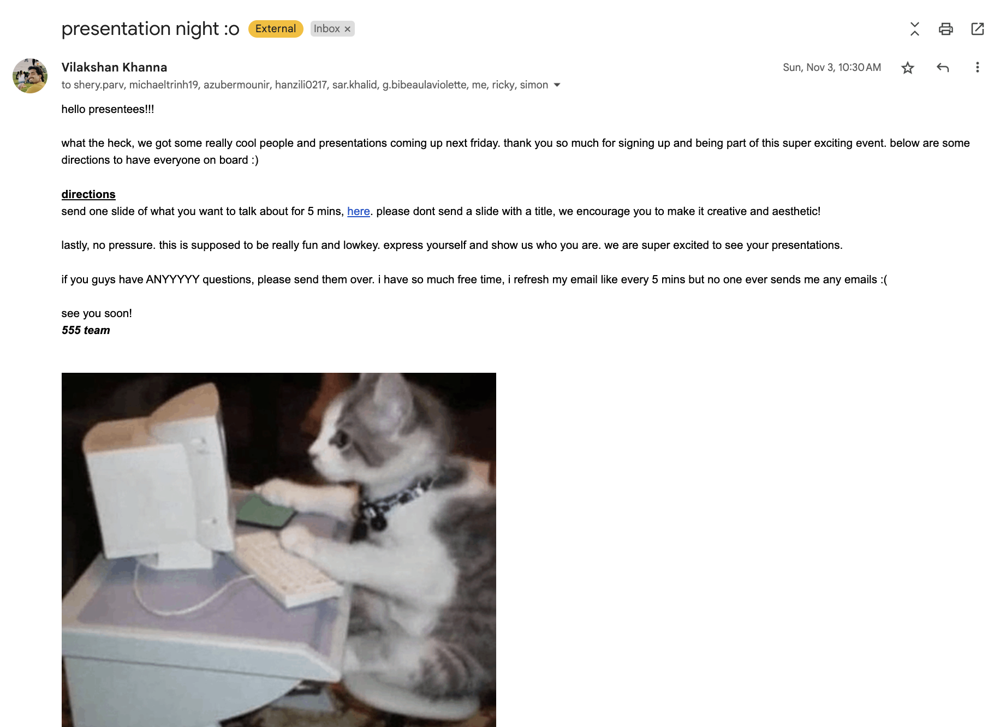
  <em style="display: block; text-align: center;">Vilakshan sending out those friendly reminder emails</em>

We also had to figure out the logistics of getting chai for everyone. We thought it was "simple" Well, turns out calculating the perfect chai-to-person ratio is its own little rabbit hole itself. After some back-and-forth texts and questionable math, we settled the quick chai calculations. The real challenge? Making sure we had enough without going overboard on the budget (spoiler: we nailed it).

  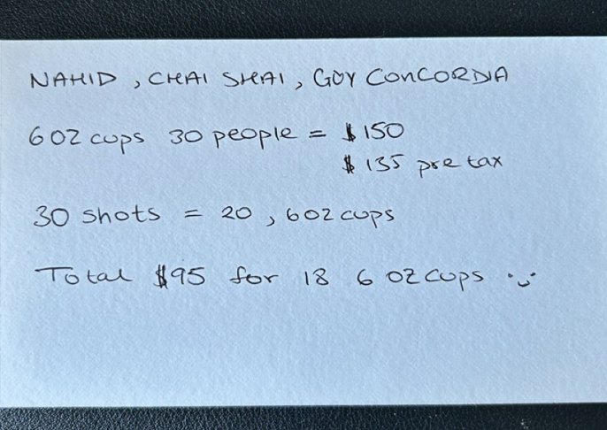
  <em style="display: block; text-align: center;">Quick maths we did to calculate how much chai we needed</em>

The whole thing was coming together piece by piece, and honestly? The chaos was half the fun. While it might sound like Vilakshan carried this whole thing, I swear the rest of us (Chris, Ricky, Simon) weren't just sitting around...

  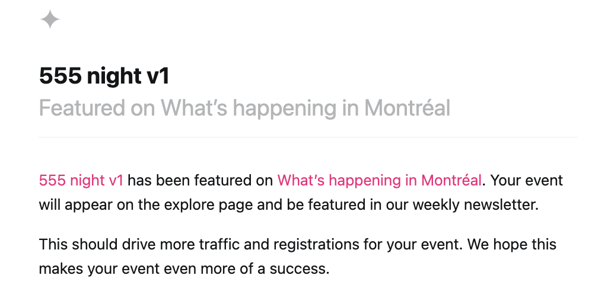
  <em style="display: block; text-align: center;">We made it to Montreal's Event of the Week on Luma!</em>

  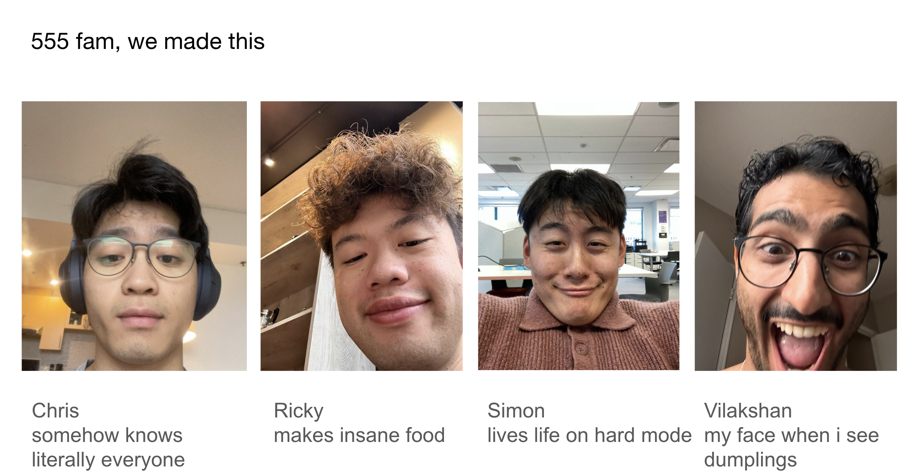
  <em style="display: block; text-align: center;">The boys were ready!</em>

 
**_November 10 (D-day!)_**
 

D-day was nuts. Vilakshan and Ricky went on a chai run that turned into a whole adventure - mostly because Ricky couldn't find parking anywhere (near Building 21 at least).
Meanwhile, Simon and I were scrambling to make sure 40 people could have some sort of a seat, while Vilakshan kept blowing up my phone to e-transfer him the chai money in real time lol (he swears hes not broke)!

Just when we thought we had it all figured out, I hit Vilakshan with the "where's the Timbits?" - fuck, he forgot. I sent him over to get them, luckily Tims was opposite Building 21 (shoutout to amazing sponsors) and we were ready to roll!

The real magic kicked off before 6pm when people started flowing in - and holy moly, the vibes were IMMACULATE. Everyone was genuinely hyped to be there, sharing that perfect mix of nervous excitement and creative energy. By 6:15pm, we had our first presenter up and it was just pure gold from there. Eight absolute legends shared their passion projects and random obsessions - each one better than the last. Not gonna spoil all the goodness, but here's a little teaser:

  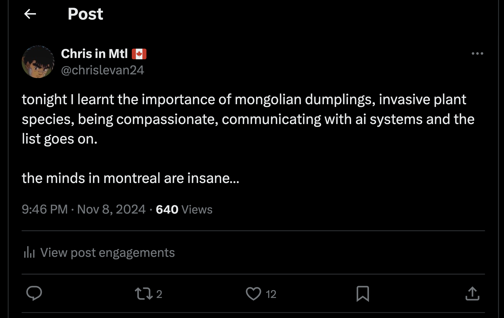
  <em style="display: block; text-align: center;">What I learnt on during my very first 555 night</em>

The best part? Watching everyone vibe over homemade chai and Timbits between presentations, making connections and sharing ideas. It wasn't just presentations - it was this perfect mix of cozy hangout meets show-and-tell meets creative playground.

  
  <em>Successful day with the coolest people for our first 555 night v1</em>

  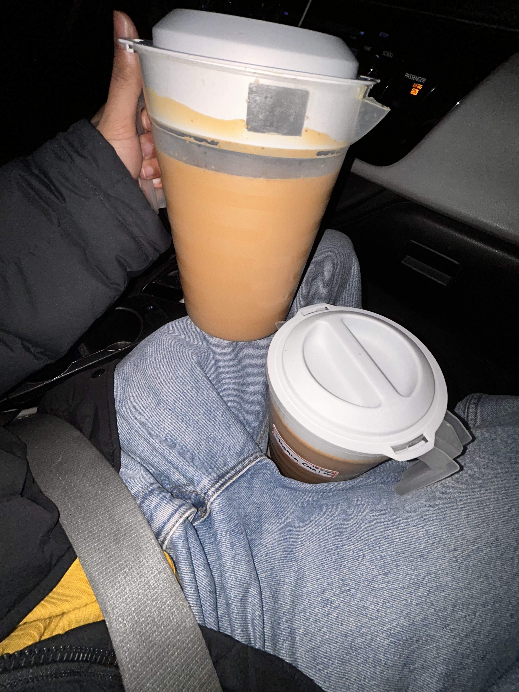
  <em>Serving up some homemade chai courtesy of Vilakshan and Ricky!</em>

  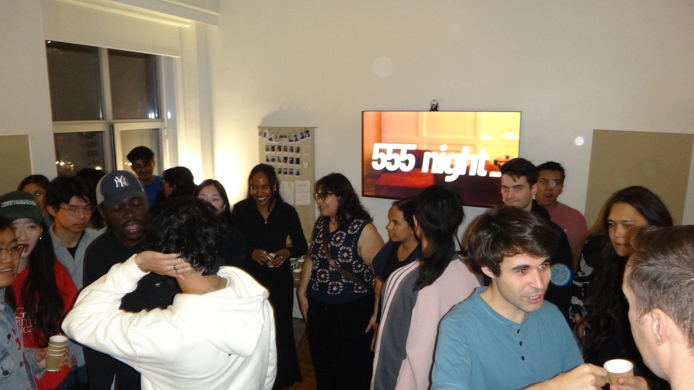
  <em style="display: block; text-align: center;">some cool photos from Vilakshan's camera</em>

 

  

    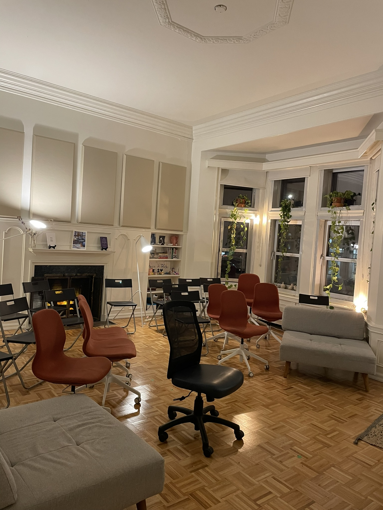
    <em style="display: block; text-align: center;">Before </em>
  

  

    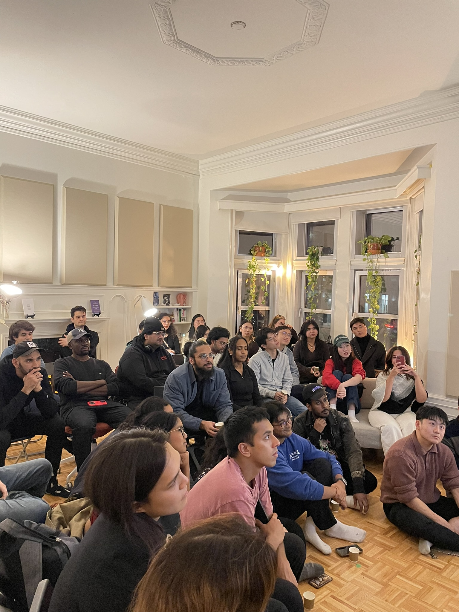
    <em style="display: block; text-align: center;">After</em>
  

_Further Learnings_

**Challenges**

- Making everyone feel at home

  - To create a space that goes beyond just tech talk
  - Four tech bros hosting meant we wanted focused on bringing different perspectives outside our circle
  - Trying to shift focus to creativity and ideas rather than technical details
  - Keeping presentations casual, conversational and on time
  - Letting room for natural connections to form

- Behind the scenes stuff
  - Vilakshan submitting slides right before (as usual)
  - Ricky's endless search for parking downtown
  - Figuring out how much chai we actually needed
  - Simon handling the unexpected turnout
  - Last-minute snack runs and sponsor hunting for Chris

**For next time**

- Rebrand from 'passion projects' to 'nerding out' - keeps it casual and fun
- Create a wall of fame with presenter portraits
- Set the mood right - dimmed lights for better vibes
- Explore themed nights (tech/food/art/music?)
- Level up the food game:

  - Let people bring their food (hotpot type situation)
  - Vilakshan's dumplings
  - Host a dumpling-making competition (thanks tommy for inspo)

**Much love from the 555 team! If you've read all the way here or came to support us, we really appreciate it! This was just the first of many - stay tuned for the next one!** ❤️
