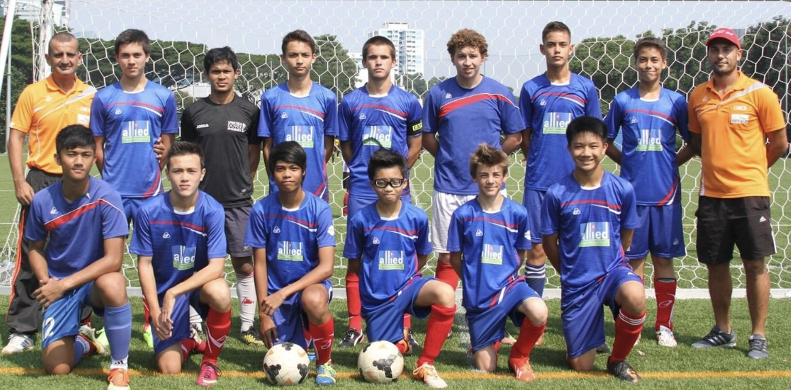

  
  <em style="display: block; text-align: center;"> i was a scrawny little kid playing for U16 team at 13 years old.
  (third from right first row) </em>

Football (or soccer as it's called here in North America), has been running through my veins since I was very young kid. This is my love letter to the beautiful game. To the childhood dreams of going pro, the injuries, and the pure joy of chasing around that leather sphere with your mates. It's more than just a ball - it's poetry in motion.

test
