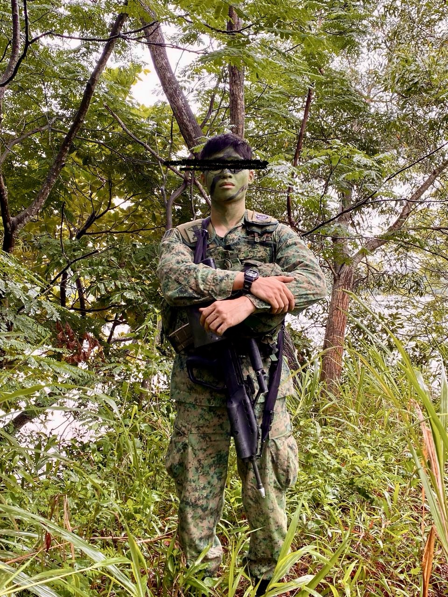
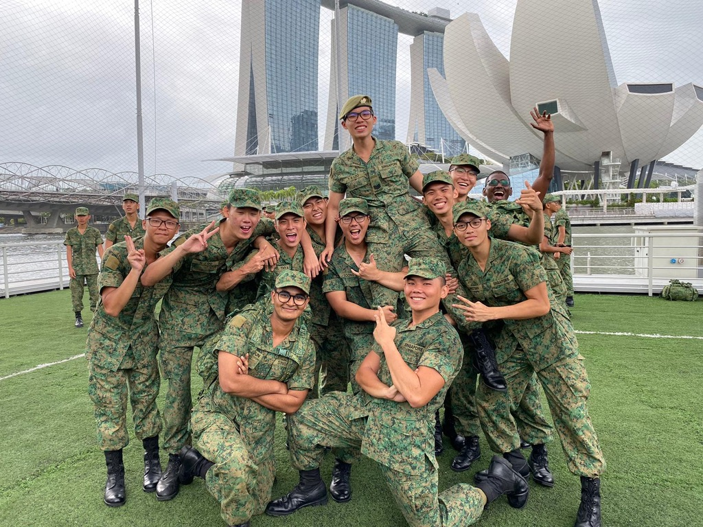
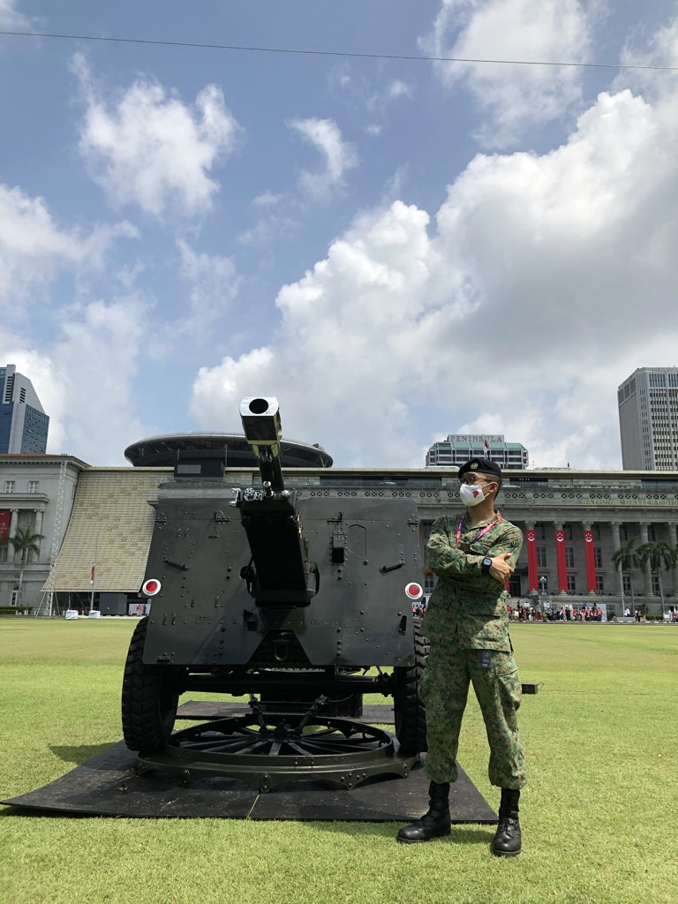
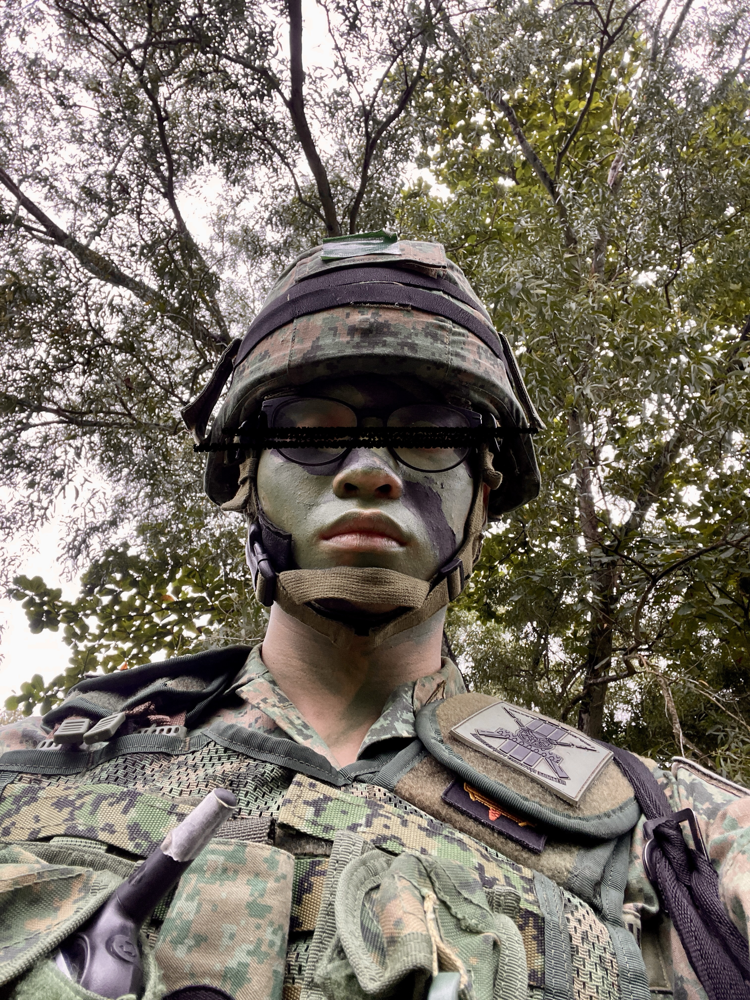
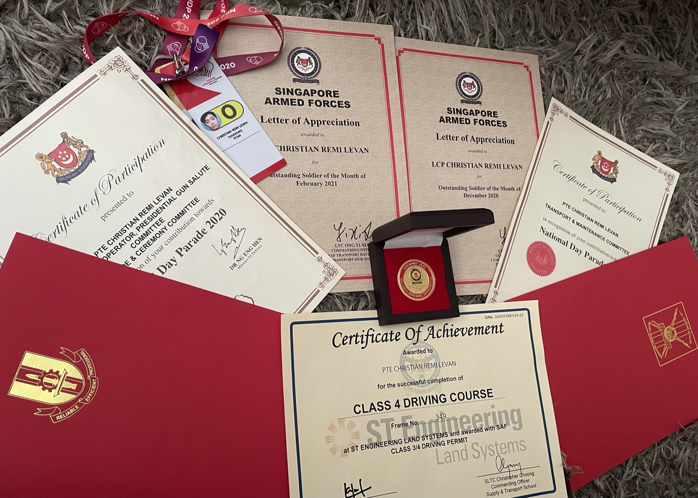
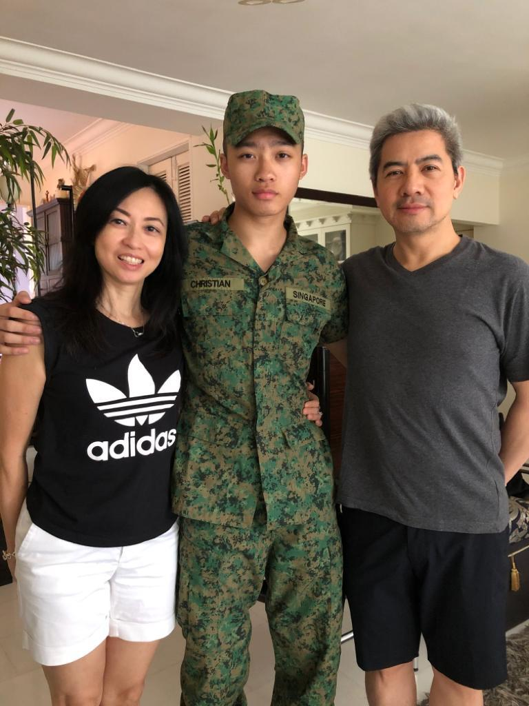

  

    
    <em style="display: block; text-align: center; font-size: 0.9em;">Taken during my last ever outfield training.</em>
  

It was around midnight. My first troop lift mission: 15 soldiers for an overnight operation. Pitch black except for my 5-ton truck's low beam cutting through the darkness. The terrain was brutal, jagged rocks, deep craters, and uneven ground that made every meter feel like a battle. No street lights, no markers, just pure darkness and the occasional sound of artillery fire echoing through the night like distant thunder.

I was sweating, nervous, as I lowered the tailboard to help lift the troops, my hands shaking as I navigated through what felt like a minefield of obstacles. My eyes were heavy from barely enough sleep the past few nights, fighting to stay alert as the truck bounced violently over the treacherous landscape. In that moment, I realized: _"I've never felt this much responsibility before. Their lives are literally in my hands."_

That night was one of the many moments that would mark the beginning of a transformation taking place over the next two years of my National Service. The army would teach me lessons about life, leadership, and myself that no university degree or job could ever provide.

The army had broken me down and rebuilt me in ways I never anticipated. It taught me lessons about life, perserverance, and myself that no university degree or job could ever provide. Lessons that would stick with me long after I folded up my uniform for the last time.

I get asked a lot what I got out of my military service. Here are some major lessons that have shaped me into who I am today.

## 1. Change is the only constant.

_"Accept humbly, let go easily."_ – Marcus Aurelius

  

    
    <em style="display: block; text-align: center; font-size: 0.9em;">Section mates and my Sergeant from Basic Military Training graduation.</em>
  

Graduating high school meant leaving behind the familiar routine I'd grown comfortable with. My friends were moving on to university while I was headed to military service: two completely different paths that would naturally create distance between us.

At first, I clung to the past, scrolling through old photos, replaying memories, wishing things could go back. Every morning in camp was a reminder that my old life was over. It was brutal, and I felt left behind as others moved forward. Those were some of the hardest times in my life.

But the truth is, nothing stays the same. Change is relentless. The people you think will always be there move on, and so do you. The sooner you accept that, the less it hurts. I learned to stop fighting the current and start swimming with it. Instead of mourning what was lost, I focused on adapting to what was in front of me.

Military life forced me to embrace new routines, new people, and a new version of myself. The lesson? Change isn't the enemy, it's the only thing you can count on to keep growing and evolving. The faster you accept and adapt, the stronger you get. Now, whenever I face major changes in my life, I remind myself of those early days in the army.

**The initial discomfort is temporary, but the growth that comes from embracing change is permanent. Whether it's starting a new job, moving to a new city, or entering a new phase of life, the same principle applies: accept humbly, let go easily, and trust that you'll emerge stronger on the other side. Just like how the human species evolved through countless adaptations to survive and thrive, your personal evolution happens through embracing change rather than resisting it.**

## 2. Control what you can control.

_"It is not what happens to you, but how you react to it that matters."_ – Epictetus

  

    
    <em style="display: block; text-align: center; font-size: 0.9em;">Supporting National Day Parade.</em>
  

After completing the rough 8 weeks of Basic Military Training, I was posted to an Artillery unit as a Motor Transport Operator. At first, I was extremely disappointed because I wanted to be posted to command school, but I was not deemed fit enough at the time due to past history of health issues. For a prolonged period of time, I was distraught and upset as I was not given the opportunities I so deperately wanted for a while.

Those tough moments taught me something crucial: life rarely gives you _exactly_ what you want. Instead of dwelling on what I couldn't control, I learned to focus my energy on what I could, my attitude, my effort, and my commitment to excellence in whatever role I was given.

**However, the character of winning and being good at what you do is irrespective of your circumstance. So if you're a winner, you don't quit. Irrespective of your situation, at the end of the day winners, are just winners.**

The day I accepted and embraced this new mentality was the day I focused on controlling what I could control. I put in 110% effort in every tasking and mission, regardless of size, because that was within my power. I couldn't control my posting, but I could control my attitude and work ethic. I chose to be the best at my own vocation, making my military service meaningful by focusing on what I could change.

The same applies to your life. You might not get into the degree you wanted, or your dream job out of graduation, but you can excel in whatever path you're given. A winner is a winner, and that character trait transcends circumstances. When you commit to being excellent in whatever role you find yourself in, opportunities will naturally open up because people recognize and reward that winning mindset.

## 3. Comparison is the thief of joy (mostly).

_"The grass is always greener where you water it."_  
— Neil Barringham

  

    
    <em style="display: block; text-align: center; font-size: 0.9em;">Having the "time of my life!"</em>
  

In high school, I was constantly comparing myself to others. I'd look at my classmates' grades, their achievements, their social circles, and measure my worth against theirs. This comparison game made me miserable. I was never good enough because there was always someone better at something. The same destructive habit followed me into the army.

When I failed to get posted to command school, I immediately started comparing myself to those who did. I'd watch other soldiers excel in areas I struggled with, some were faster runners, better marksmen and more skilled operators. Instead of focusing on my own growth, I was stuck in a cycle of measuring myself against everyone around me.

The problem wasn't that I was comparing myself to others, it was how I was doing it. I was using comparison as a weapon against myself, constantly finding reasons to feel inadequate. Every time I compared, I came up short, which only reinforced my self-doubt.

**But then I realized something that changed everything: the only person I should be comparing myself to is the person I was yesterday. Instead of asking "Am I better than him?" I started asking "Am I better than I was yesterday?"**

I took every day as an opportunity to be 1% better than the day before. Not better than the soldier next to me, not better than my high school classmates, but better than myself. This shift in mindset was liberating. I stopped competing against others and started competing against my own potential.

The army taught me that true confidence comes from focusing on your own journey and progress. When you stop measuring yourself against others and start measuring yourself against your own growth, you'll discover you're capable of far more than you ever imagined.

## 4. Observe, adapt and succeed faster.

_"It is not the strongest of the species that survives, nor the most intelligent that survives. It is the one that is most adaptable to change."_ — Charles Darwin

  
  <em style="display: block; text-align: center; font-size: 0.9em;">A few awards after my 2 year service.</em>

As a third culture kid, I was born in Japan and moved around a lot as a child. Although I spent most of my childhood I could remember in Singapore, I wasn't fully Singaporean and wasn't indoctrinated in the same schooling or mindset as most Singaporean kids growing up.

Because of this, I had to adapt fast. The thing about the military is you get put into groups of men and platoons of people where you all come from all walks of life, backgrounds, races, etc. I had to adapt, make new friends, and learn to build a support system.

**The biggest thing I learned about adapting is to be observant of the small things, identify patterns, relationships, and dynamics. It can get political as well, so you need to know when to listen, when to back down, when to stand up for yourself, and when to just keep yourself out of trouble.**

The army taught me that when you're thrown into the unknown, your survival depends on being observant. You have to watch, listen, and pick up on the subtle cues that tell you how to navigate unfamiliar territory. I learned to read the room, understand power dynamics, and identify who I could trust versus who I needed to be careful around.

This skill became my lifeline when I moved to Canada alone at 20, fresh from the army. I had to observe how people interacted, what the cultural norms were, and how to build relationships in a completely foreign environment. The key is that observation comes before adaptation. You can't adapt to what you don't understand, and you can't understand what you haven't observed.

The faster you overcome that activation energy and get things going, the faster you will succeed.

## 5. Appreciate the little things in life.

_"He is a wise man who does not grieve for the things which he has not, but rejoices for those which he has."_  
— Epictetus

  

    
    <em style="display: block; text-align: center; font-size: 0.9em;">Most important people in the world to me.</em>
  

Lastly, but most importantly, I learned the sole most important thing that the 2 years of military service have taught me: to appreciate the little things in life. When you're stripped of your usual comforts and routines, you begin to value the simple pleasures a good meal, a comfortable bed, a hot shower, or even just a few minutes of peace and quiet.

The army taught me gratitude in a way I never experienced before. I learned to find joy in small moments and to not take anything for granted. This perspective has stayed with me long after my service ended and has made me a more appreciative and content person.

**Sometimes you're so focused on the grind you tend to forget your day 1 supporters like your family and friends that make it all worth it to keep pushing. These 2 years were a reminder to never take those for granted ever. Tomorrow is not promised, so cherish the people who have your back today.**

## Final Note

The army didn't just teach me how to be a soldier, it taught me how to be resilient in the face of change, focused on what I can control, confident in my own journey, adaptable to new environments, and grateful for life's simple blessings.

These lessons have become the foundation of who I am today, and they continue to guide me through every challenge life throws my way. If you read it until here, I appreciate you sticking around and I hope you can take away 1-2 things to implement in your day-to-day life.

_The concepts, methodology and procedures mentioned in this article are purely assertions of my own personal opinion and have no bearing whatsoever on the official operations protocol of the Singapore Armed Forces. No sensitive information is presented in this article._
