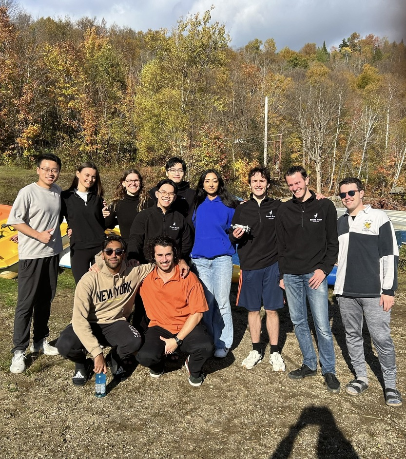
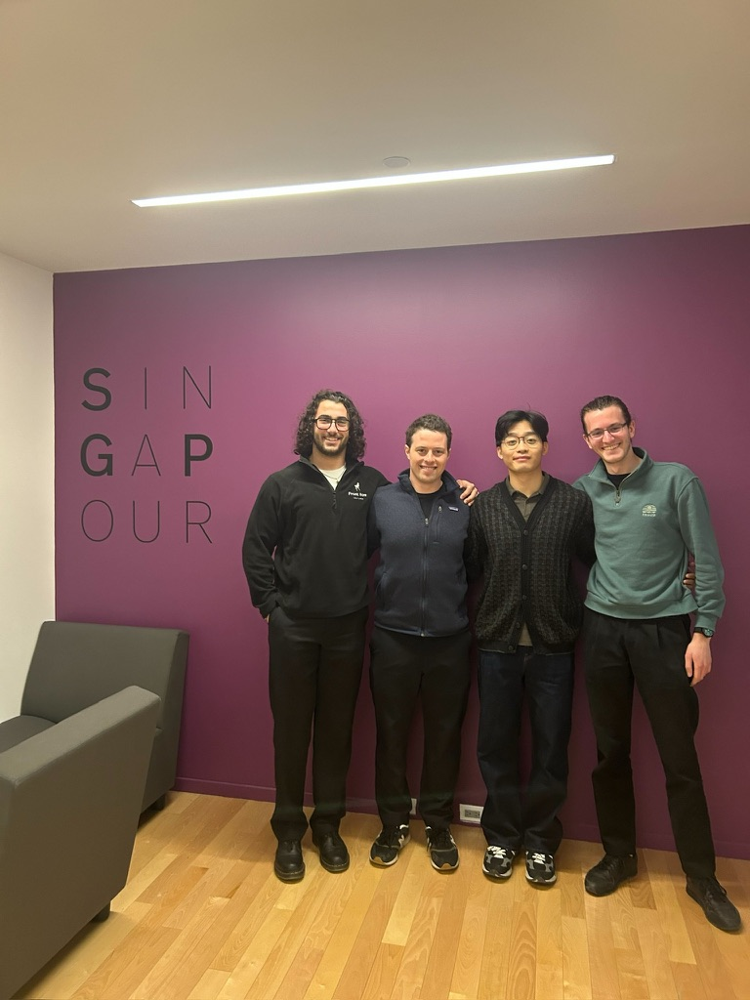
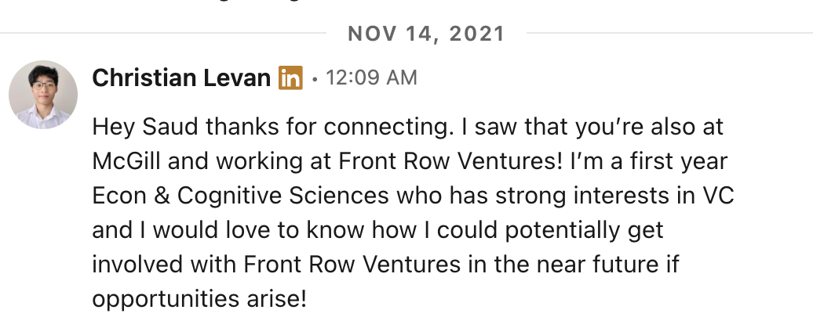
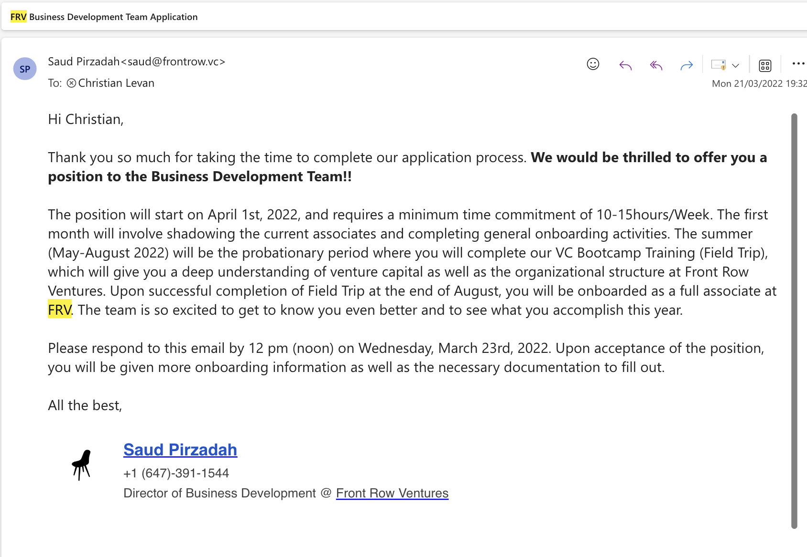
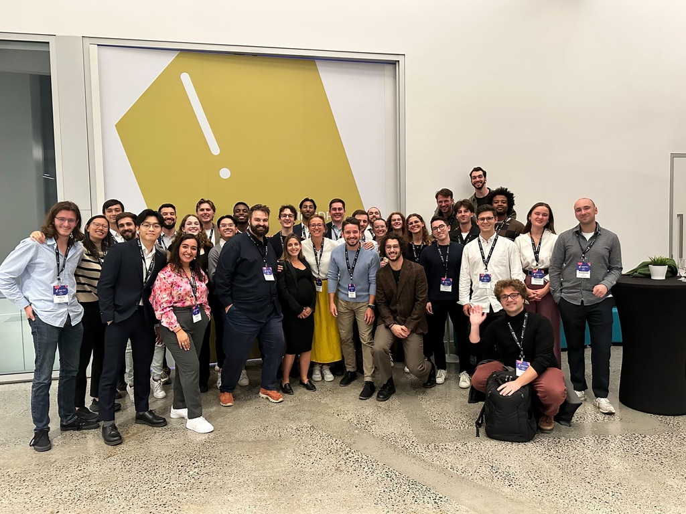

### Prelude

I'm writing this a few weeks out from my official end date at [Front Row Ventures](https://frontrow.ventures/) (FRV), which is definitely the most bittersweet feeling I've ever felt about something.

After these 3 years, it has been a magical journey for me. I really owe FRV a lot in my learning journey - from someone who had no idea what VC meant to being able to do this full-time after graduation is something that would never have been possible without FRV.

_If you are reading this and are either thinking of joining or starting out at FRV, I would love to share with you my lessons & core experiences that made this so magical for me and show you how to make the most out of it._

  

    
    <em style="display: block; text-align: center;">FRV Retreat</em>
  

  

    
    <em style="display: block; text-align: center;">At the office with the other Directors</em>
  

### The Beginning

My first ever coffee chat reach out when I was a naive first year at McGill was to this fellow economics student who was in his senior year called Saud. At that time I was in a completely different program and was balancing between economics, cognitive sciences, philosophy and deciding which I should pursue.

  

By pure coincidence, I just ran into Saud's LinkedIn profile and decided to just "shoot my shot" to see how he was thinking about his career past McGill with an economics degree. He was also involved with this organization called "Front Row Ventures," which seemed pretty interesting to me at the time. I won't lie, mentioning "strong interest in VC" in that initial reach out was half a bluff but seemed to have paid off.

Saud replied, we hopped on a call, funnily enough he did not mention his economics degree one bit and he just jammed on how amazing FRV was. He encouraged me to apply in the next semester and so I did that.

### Lesson 1: Just get your foot in

FRV has several teams, with the investment teams being the most competitive. These typically attract students with finance backgrounds or specialized knowledge in life sciences or something technical - neither of which I had as a first-year student.

I played to my strengths when applying. My GPA was bad at the time so my profile was also nothing too special. I leveraged my existing connections with Saud and Godwin on the current team, highlighted my unconventional background in military service and entrepreneurship, and targeted the Biz Dev team where these qualities would be valued. I focused on getting in first, then making an internal transfer once I'd proven myself. This worked - I got my foot in the door and eventually made my way to where I wanted to be.

I remember telling my partner, "After a year of learning the ropes, my goal is to transfer to the investment team." **The lesson? Get your foot in the door first. You can make lateral moves later once you've built relationships and demonstrated your value.**

Luckily enough, I got in and from then I knew that this was just the start:

  
  <em style="display: block; text-align: center;">The acceptance email that changed everything</em>

### Lesson 2: Be Reliable & Maximise your "Luck"

My first year at FRV was about reliability despite my knowledge gaps. I managed the ESPACE CDPQ account, planning events at a Montreal VC hub, which gave me rare exposure to working directly with FRV's Managing Partner Manue who was helping to oversee this account.

I turned this opportunity into an advantage by:

- _Creating my own luck_: I strategically introduced myself to investors at events, leveraging my organizer role to build connections. This paid off when I spotted an Inovia Capital investor and mentioned my pending application. That two minute conversation got me a first interview, which led to my internship offer later—proof that being in the right place creates opportunities automated systems miss.

- _Proving reliability_: I responded quickly, took initiative, and delivered consistently on all tasks for Manue and the ESPACE CDPQ account, treating every assignment as a chance to showcase my execution skills.

This reliability built leadership trust and opened doors to the investment side. When applying for Director of Investment, I was attempting something unprecedented - no platform team member had ever become Investment Director at FRV.

**Key lesson: Reliability builds trust, and creating your own luck means showing up where opportunities happen. That two-minute investor conversation led to an internship precisely because I put myself in the right place at the right time and mazimised my "luck".**

  
  <em style="display: block; text-align: center;">Event at ESPACE CDPQ</em>

