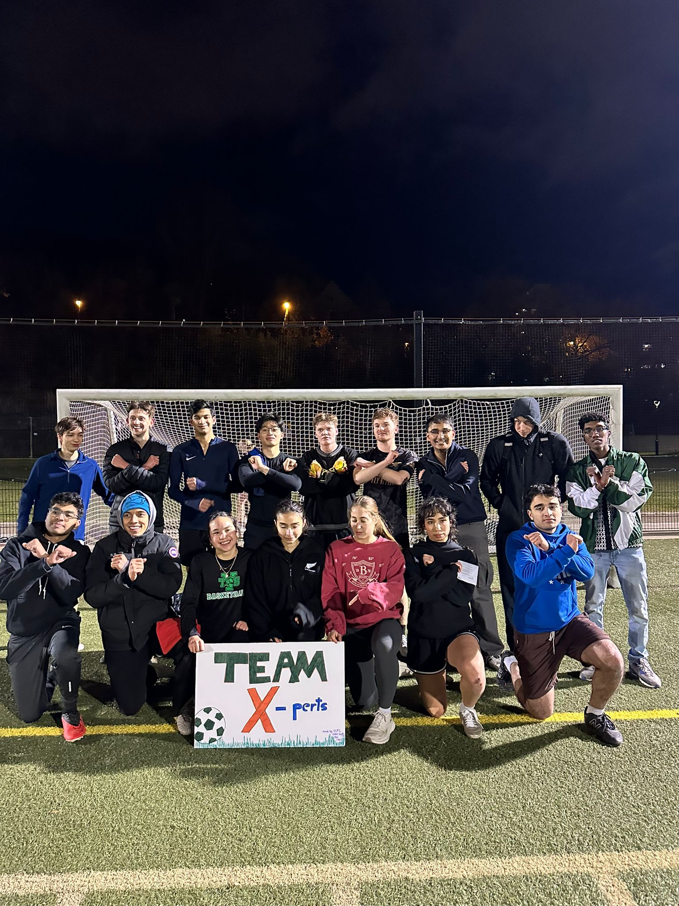
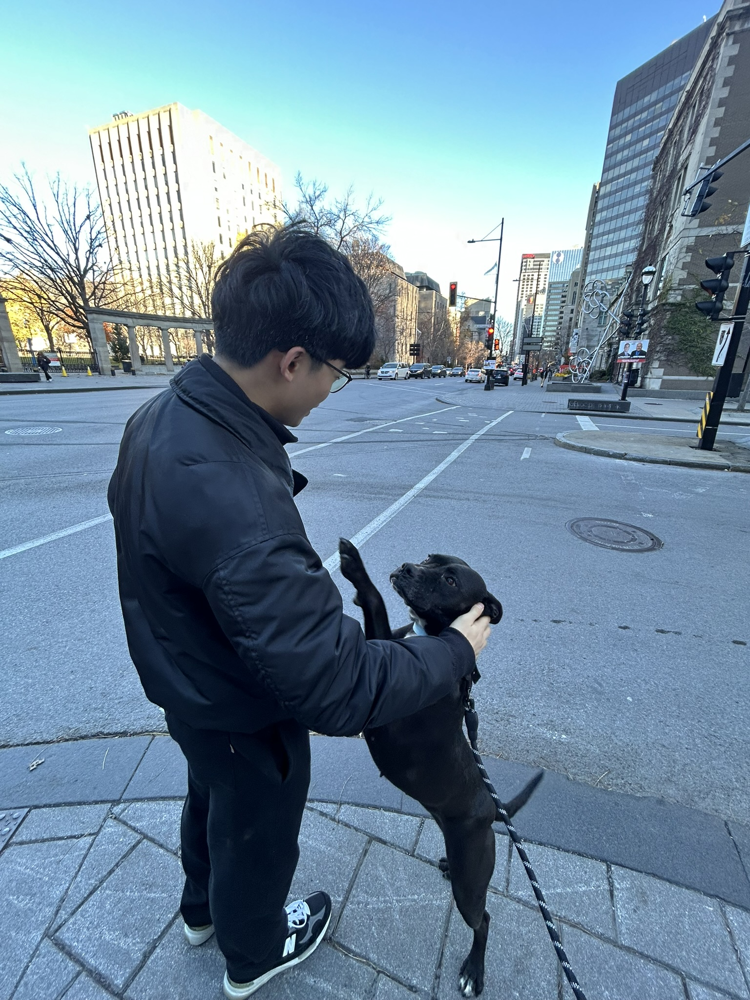
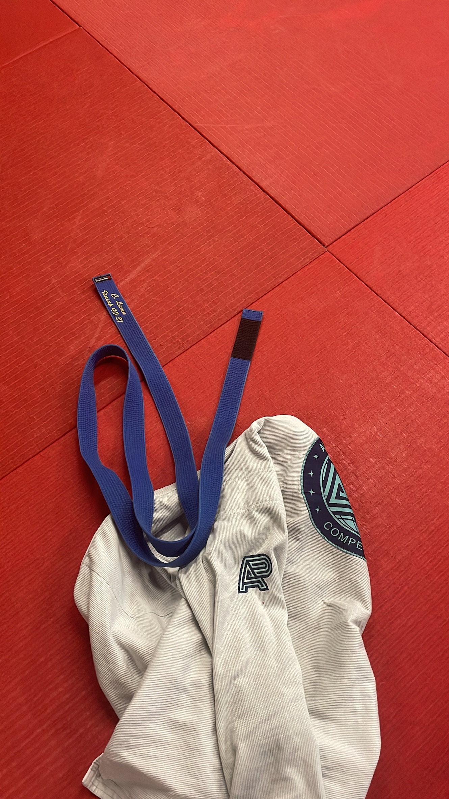

- enjoy my last full semester of school while it lasts.
- spend time with my loved ones (friends and family back in Singapore).
- reflect on the highs and lows of 2024, what do i want to get our of 2025?
- get back to training bjj 3x a week post injury.
- attempt to run my first half marathon.

while you're here, enjoy some of these random photos from my recent camera roll

  
  <em style="display: block; text-align: center;">Playing intramural footyball with the lads</em>
  
  <em style="display: block; text-align: center;">my gf and i adopted a dog from turkey for a night</em>
  
  <em style="display: block; text-align: center;">Back to training after the shoulder injury</em>

