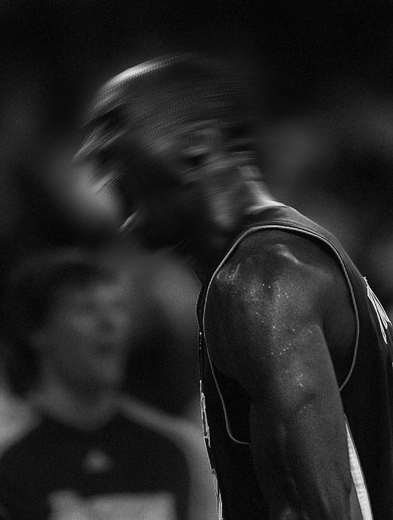

  

_"I wish upon you ample doses of pain and suffering."_

that was jensen huang, ceo of nvidia, speaking to a room full of stanford students in 2024. the room went silent. then erupted in laughter. but he meant every word.

his full quote: _"greatness comes from character. and character isn't formed out of smart people, it's formed out of people who suffered."_

i've been thinking about this quote a lot. and as i sit here reflecting on the last decade of my life, from 2016 to 2026, i think i finally understand what he means.

the last 10 years have had some really dark moments for me.

friendship and relationship breakups that shook my sense of self. big failures i didn't see coming. goals i worked hard for and didn't reach. injuries that kept me off the things i loved. stretches of very low self-esteem, from bullying and from constantly measuring myself against everyone around me. periods where i genuinely didn't know who i was or where i was going.

in those moments, it's easy to feel like the pain has no purpose.

but here's what i've come to realise: every single one of those moments became fuel. every failure made me hungrier. every loss made me want to prove something, to myself, to the people i cared about, to the version of me that almost gave up. every moment where things didn't go my way forced me to find a different way, a better way.

the army taught me what real discomfort feels like. the injuries taught me patience and humility. the losses taught me that time is the only thing i can never get back. the comparisons i tortured myself with eventually pushed me to stop looking sideways and start looking forward. even the bullying, as much as it hurt, lit a fire in me that i don't think anything else could have.

none of that growth happens without the suffering. none of it.

seneca, the roman stoic philosopher, said it well: _"fire tests gold, suffering tests brave men."_

and the proportionality is something i keep coming back to. the bigger the suffering, the bigger the win on the other side. the larger the hardship, the larger the celebration when you come out of it. they are almost perfectly proportional. the things that hurt the most in my life have also produced the biggest leaps forward, in who i am, in what i can handle, in how far i've come.

i'm not afraid of pain anymore. honestly? i'm kind of addicted to what it produces.

i've reached a point where i can't wait to be challenged again, to fail again, to struggle and to feel that hunger again, because i know what comes after. the glory on the other side of suffering hits different when you know what it cost you. and the harder it was to get there, the sweeter it feels.

so if you're in a painful moment right now, don't waste it. use it. the pain is the work.

and for everyone else, i wish you ample pain and suffering. i mean that with love.

If you enjoyed this, you might like:
- [[lessons from 2 years as a conscripted soldier.]]
- [[a reminder in hard times]]
