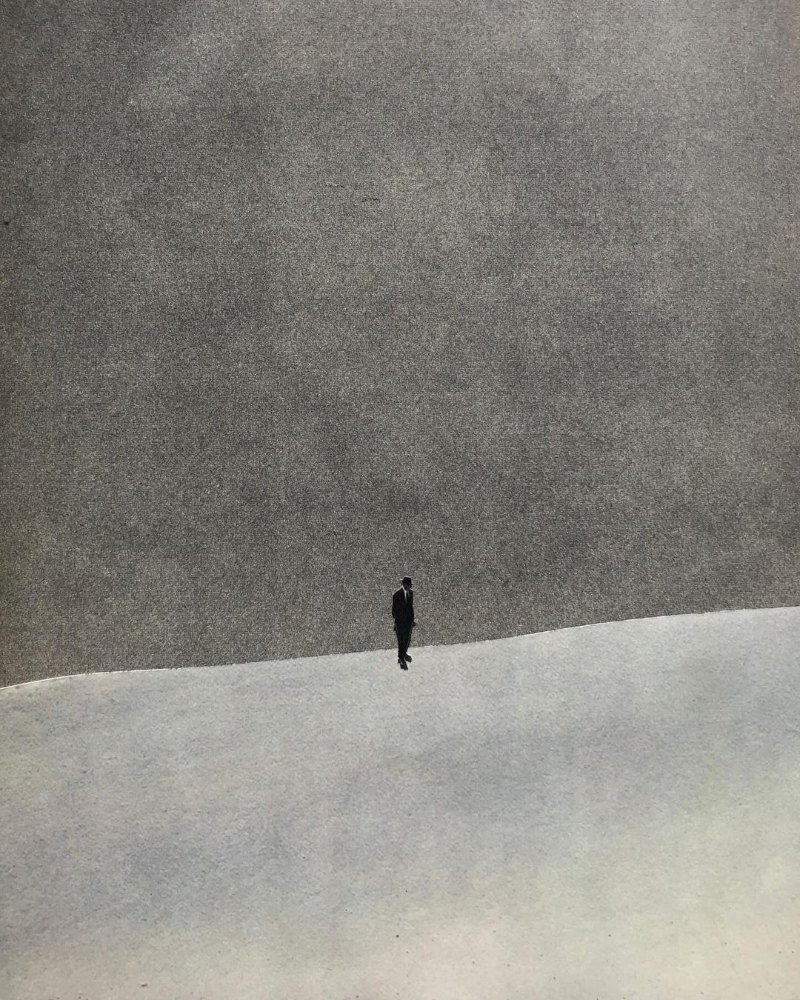

  

some people just know. they wake up one day and they have this burning problem they need to solve. elon musk wanted to make humanity multi-planetary. malala yousafzai nearly died for girls' education and kept going. they had a calling. something so deep and so clear that their entire life orbited around it.

for me, it was never that clear.

i spent a long time feeling lost because of it. i thought something was wrong with me. i'd look at these people and think, where's my thing? where's the problem i'm supposed to dedicate my life to? i kept waiting for it to hit me, like one day i'd wake up and just know.

it never came.

and for a while, that messed with me. i felt like i was falling behind because i didn't have this grand mission. like everyone else had figured it out and i was still searching.

what i slowly realized is that a lot of people don't have that calling. and that's okay.

not everyone is born with a singular mission. not everyone needs to have one problem they're solving for the rest of their life. and pretending you do when you don't just leads to frustration.

what i've found instead is something simpler. my purpose, for now, isn't problem-based. it's waking up every day and trying to tell myself i'm 1% closer to where i want to be. it's seeking discomfort. seeking curiosity. trying to be the greatest version of myself i can be, even when i don't know exactly where that leads.

i think in this day and age, where everyone is broadcasting their mission statements and life purposes on social media, it's easy to feel like you need one too. but maybe you don't. maybe the search itself is the point.

so if you're out there feeling lost because you don't have a calling yet, this is your reminder that you're not behind. keep moving. keep being curious. keep getting 1% better. the meaning will find you.

If you enjoyed this, you might like:

- [[the one habit you can't track.]]
- [[i wish you ample doses of pain and suffering.]]
