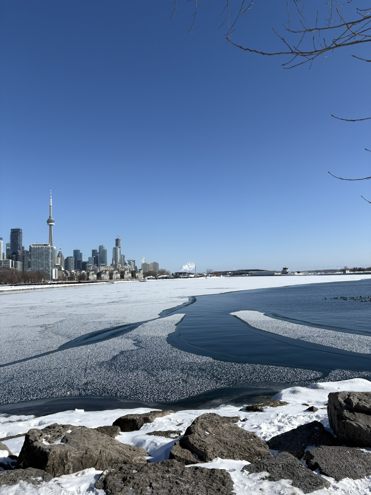
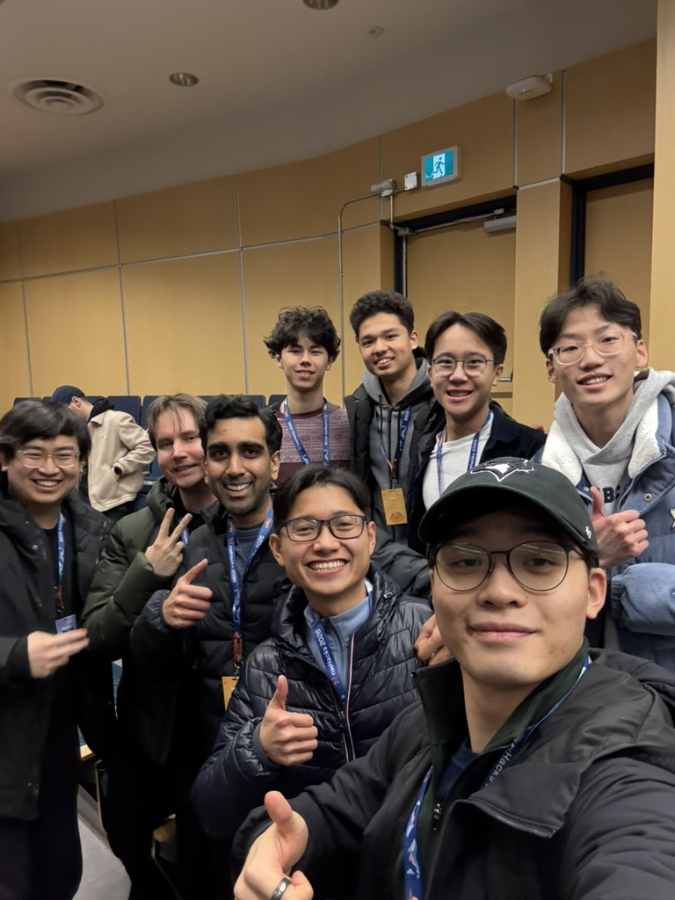
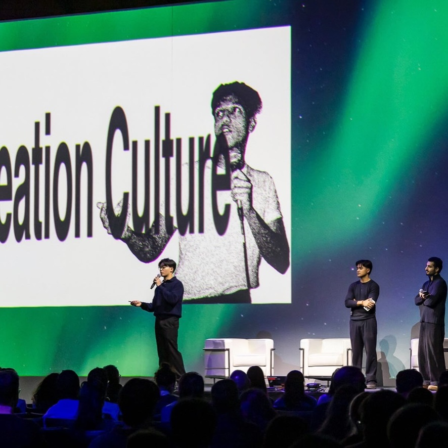
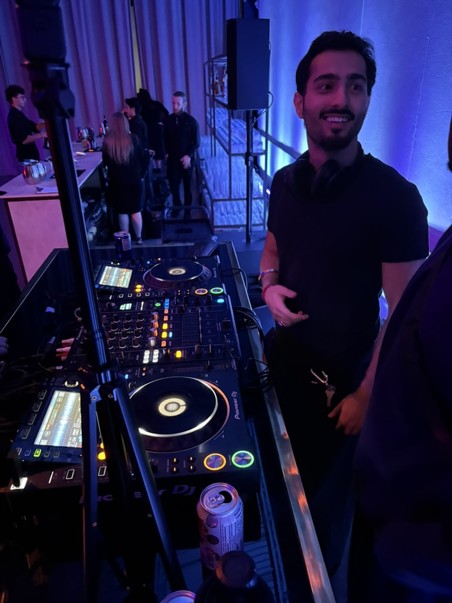
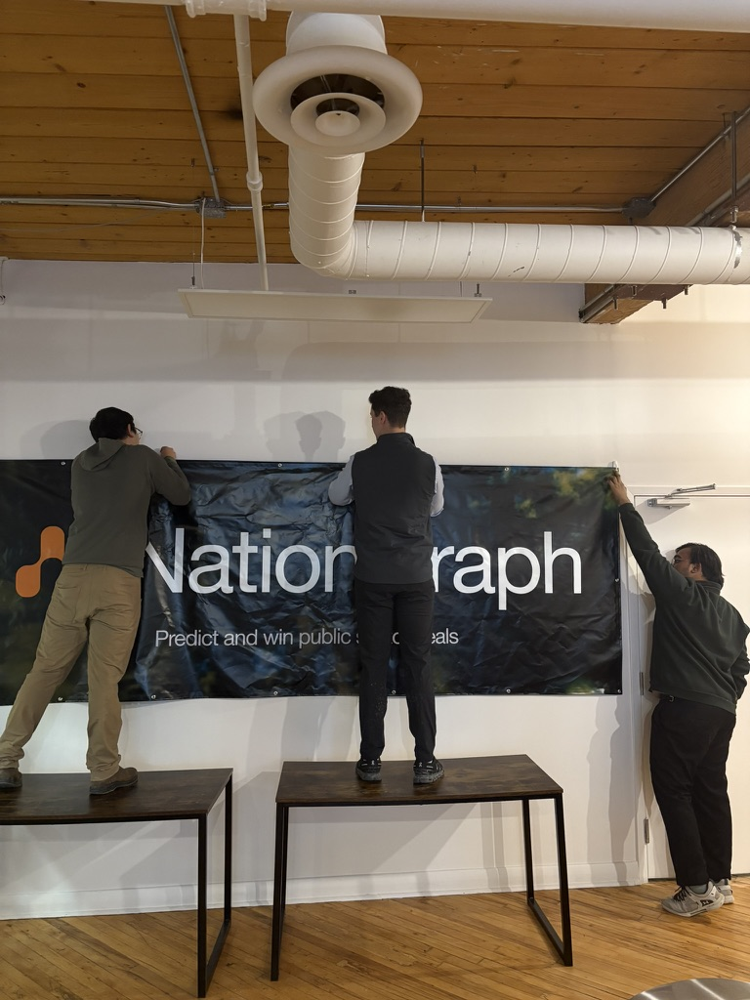
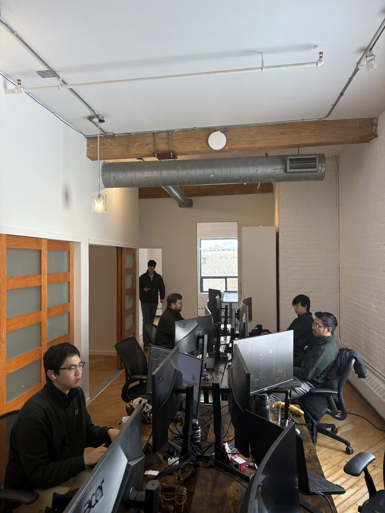
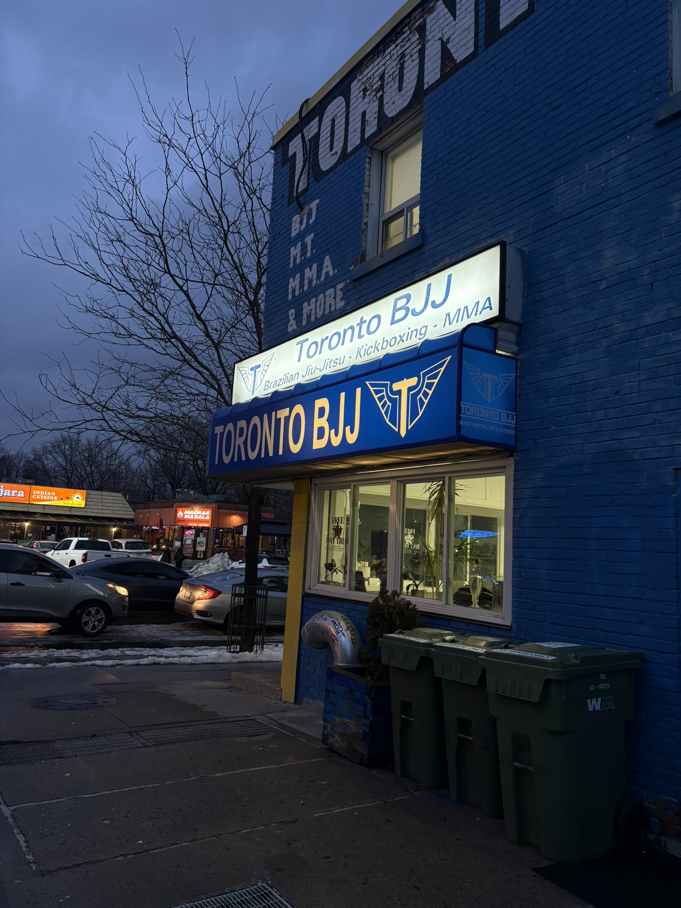

### what's been happening

what a start to 2026. new city, new job, new chapter and honestly it's been everything i hoped it would be and more. here's a quick overview of what's been happening so far:

  

    
    <em class="photo-caption">Welcome to Toronto</em>
  

### travels

- took my first ever trip to vancouver in my first week at the new job for a company hackathon. safe to say i was thrown straight into the deep end and i loved every second of it.
- got to train some jiu-jitsu and eat really good sushi.

  

    
    <em class="photo-caption">hackathon crew in vancouver</em>
  

### random updates & projects

- big news: 555 was on stage at northstar! super proud moment for us and a huge milestone for the crew.
- season 2 is officially in the works. we have an event dropping on **march 13th** stay tuned, it's going to be a good one.

  

    
    <em class="photo-caption">555 on stage at northstar</em>
  

  

    
    <em class="photo-caption">vilakshan on the set</em>
  

### career

- the big move: i'm now in toronto full-time working at [nationgraph](https://nationgraph.com).
- we just closed our **series a, [$18m usd led by menlo ventures](https://www.govtech.com/biz/ai-procurement-intel-platform-nationgraph-raises-18m)**. it's been wild to be part of this journey from the jump and i couldn't be more excited about what's ahead.
- genuinely, hand on heart, this has been the most fun i've ever had working. the team is absolutely insane and i pinch myself every day that i get to work alongside these people.
- so grateful for this opportunity and excited to keep learning, especially diving deep into product marketing.

  

    
    <em class="photo-caption">setting up at the office</em>
  

  

    
    <em class="photo-caption">the team at work</em>
  

### everything else

- officially joined toronto bjj and getting back on the mats has been amazing. missed it more than i thought.
- continuing to lift consistently and recently started back on zone 2 cardio to rebuild my aerobic base properly.
- big goal for the year: **running the montreal full marathon in the fall**. it's been on the bucket list for a while and this is the year.

  

    
    <em class="photo-caption">new gym, same grind</em>
  

### what's next

- keep building. keep growing. there's a lot i want to do this year on the personal brand side, more reflections, more writing, more sharing what i'm learning.
- if you're in toronto, let's grab a coffee, always down to meet new people.

keep at it and see you all soon!

If you enjoyed this, you might like [[a little life update q4 25']].

