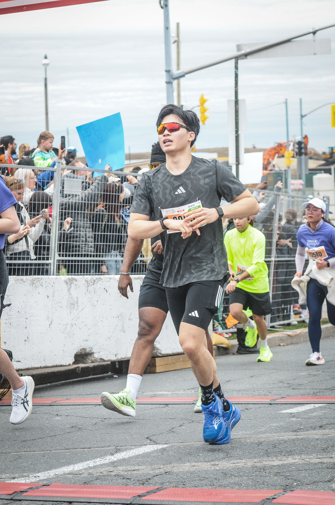
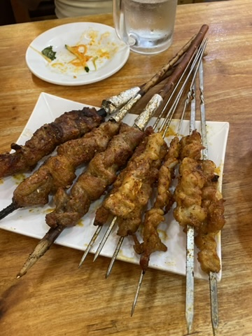
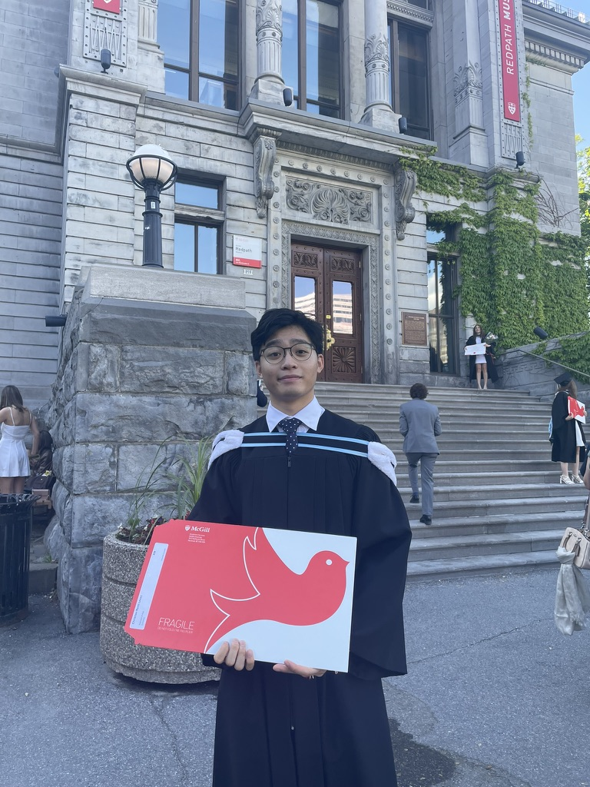
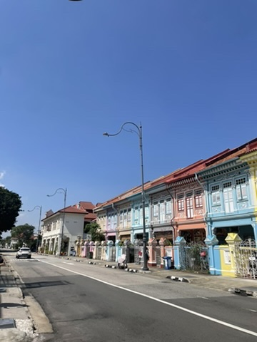
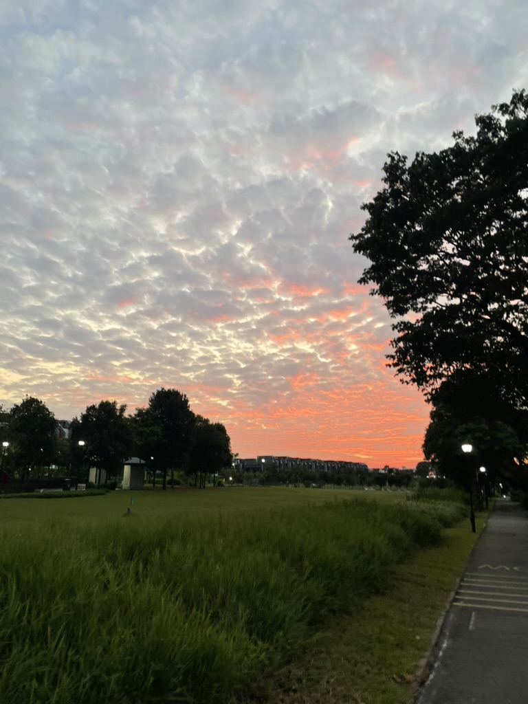
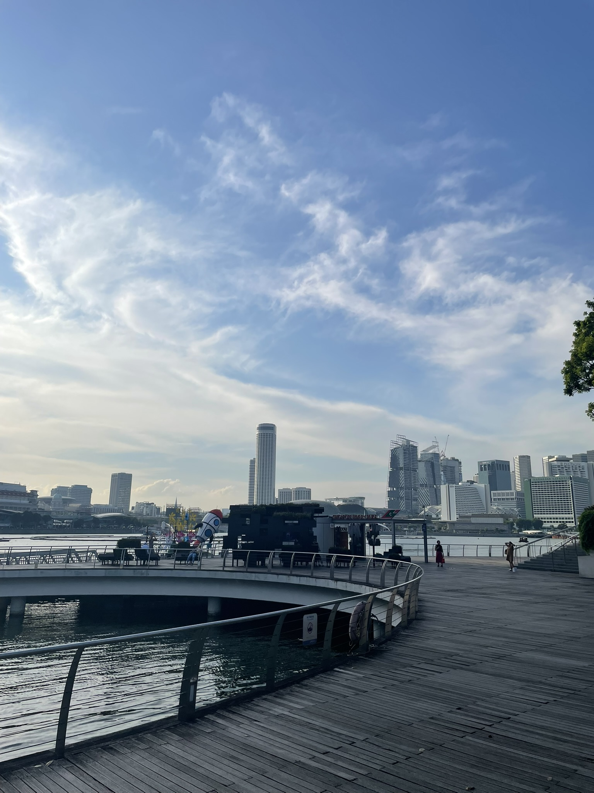
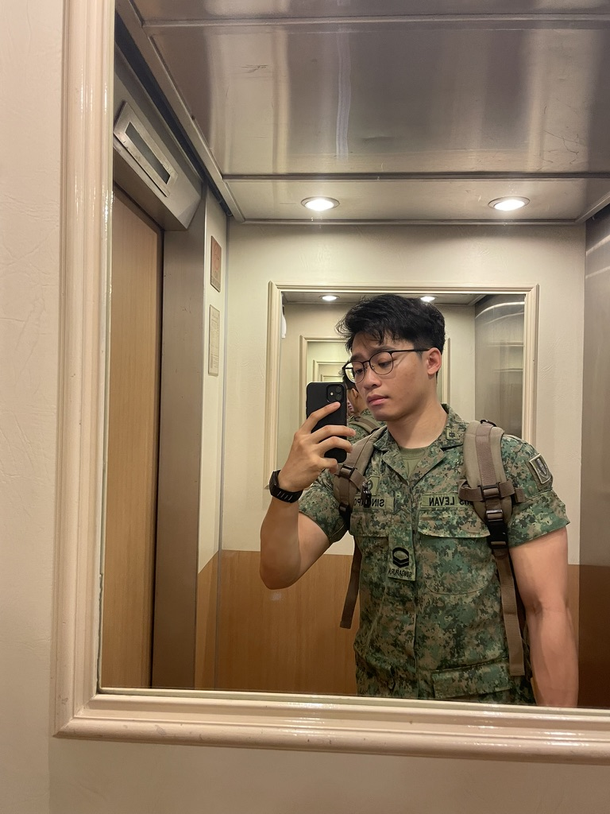
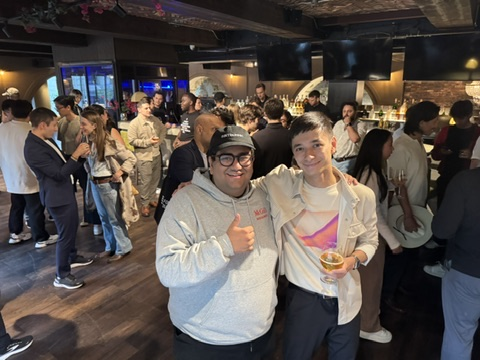
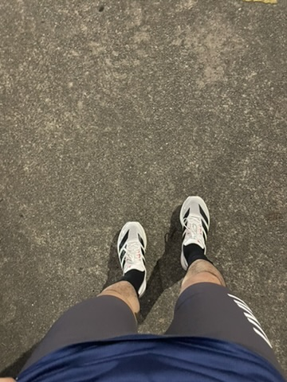
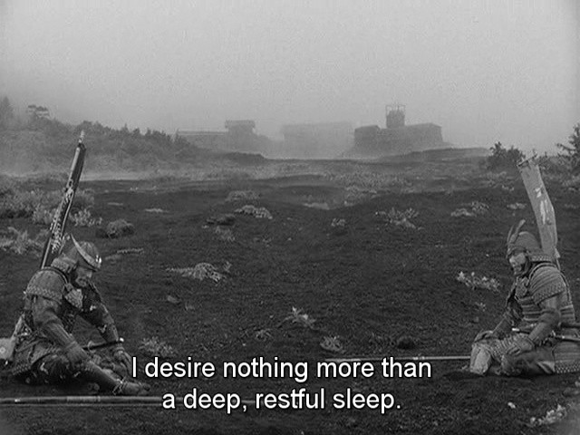

## what's been happening

- so this last quarter has been crazy to say the least! To sum it up quick: ran my first official half-marathon, passed my final cs exam, graduated, spent time with family & finishing up 2 more months of military service in singapore.

  

    
    <em class="photo-caption">first official half marathon in Toronto</em>
  

  

    
    <em class="photo-caption">singapore food hits different</em>
  

  

    
    <em class="photo-caption">graduation day</em>
  

### travels

- coincidentally every time i write one of these updates, i'm back in singapore.
- went back to singapore after graduating in june to re-enlist in the military.
- main highlight was yet again, just enjoying singaporean food, i oddly missed food in the military camps too lol?
- will be travelling japan, malaysia and briefly thailand in the next month with my girlfriend before i head back to montreal end of august.

  

    
    <em class="photo-caption">singapore scenery</em>
  

  

    
    <em class="photo-caption">sunset behind my house</em>
  

  

    
    <em class="photo-caption">marina bay sands in singapore</em>
  

### random updates & projects

- as some of you know i returned to singapore to complete 2 more months of military service. fun times, it was definitely "eye-opening" and i tried to take some positives from it. made some good friends, reinforced my discipline etc.
- the 555 crew took a few month break as we were all travelling in the summer, but we successfully finished 9 iterations of our demo nights! so much is yet to come real soon as we have crazy things planned.
- i've been doing a lot of writing and reflecting recently, it's been super therapeutic to jot down my thoughts.

  
  <em>back to base after 4 years</em>

### career

- not much on this side, will be returning to panache ventures this fall, so excited to get the ball back rolling and to continue investing in the best in canada!
- the boys hosted a 5&7 while i was gone shoutout to aaron and yoran lfg!

  
  <em>the legendary 5&7 on mondays</em>

### fitness

- going to rawdog a half marathon in singapore in 2 weeks, down with the flu recently, but going to push through. super excited it's my first race with my girlfriend who initially got me into running! i've also been training bjj back in singapore which has been fun as well.

  
  <em>no joke running in this weather</em>

## what's next

- done with the military in 2 weeks, then going to travel for a bit and come back to montreal.
- if i've been unresponsive recently it's probably because of my number change my bad! super excited to catch-up when i'm back in the great big north!
- overall it's been quite a challenging month with all the changes in my life, but being back in the army has only grown my appreciation and gratitude for things i had in my civilian life.
- keep at it and see you all soon!

  

If you enjoyed this, you might like [[a little life update q1 25'.]].
