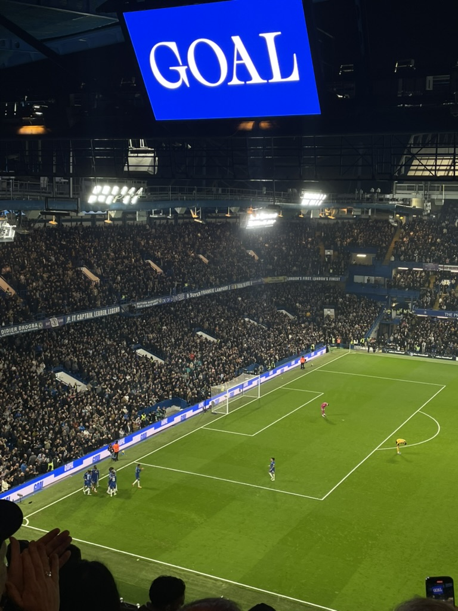
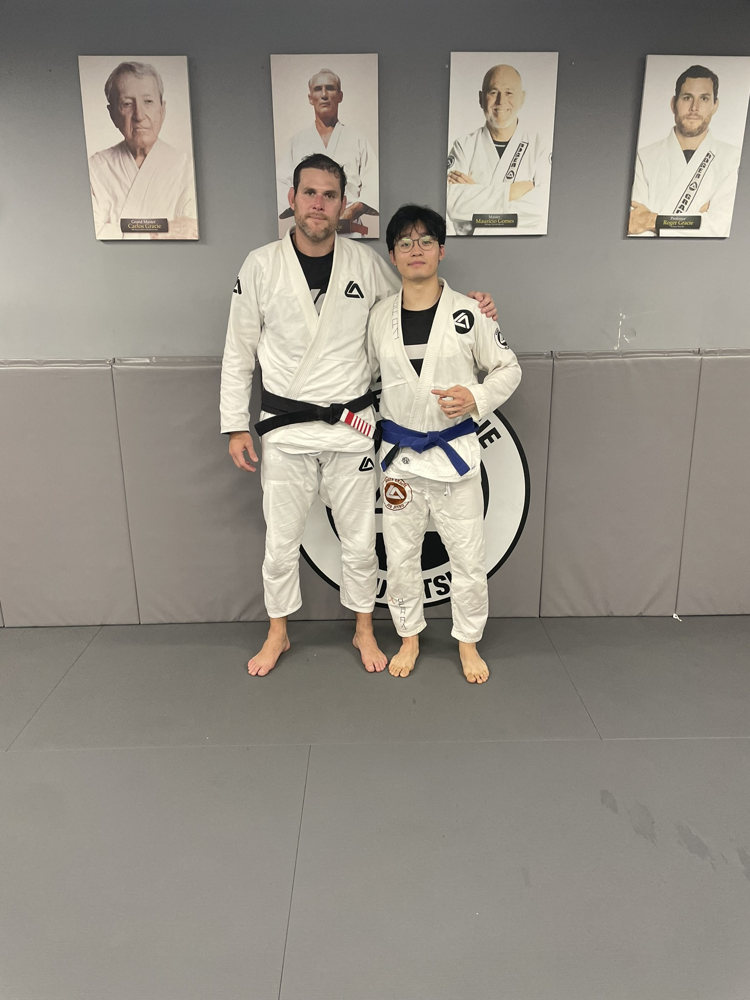
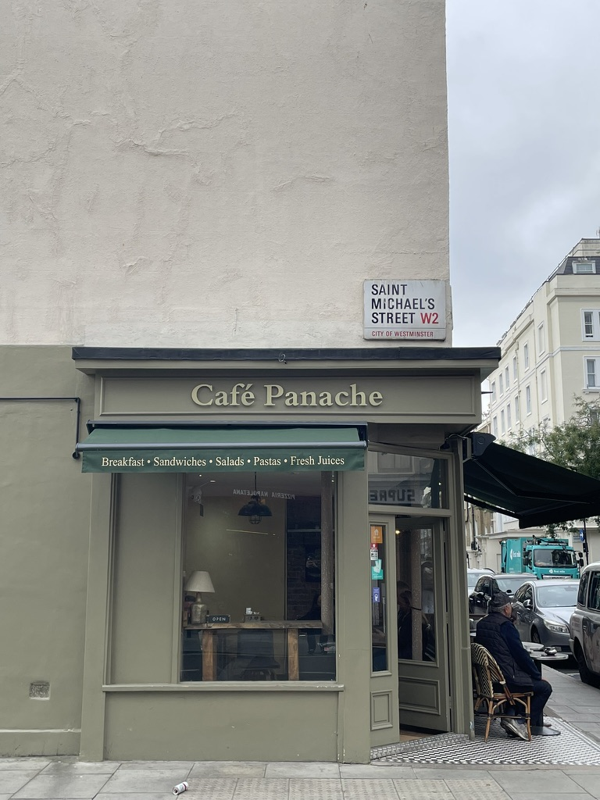
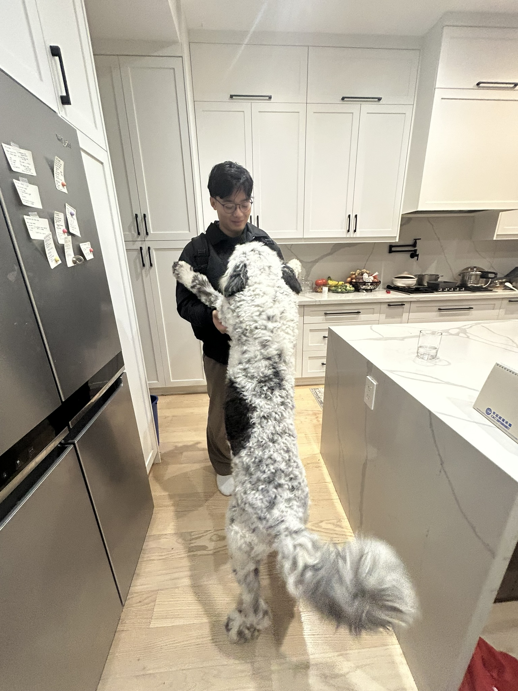
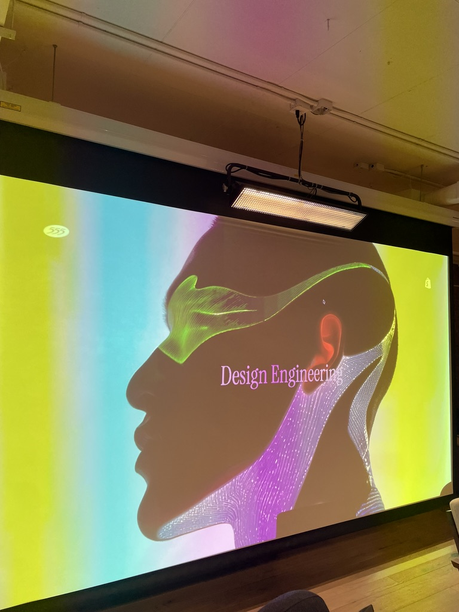
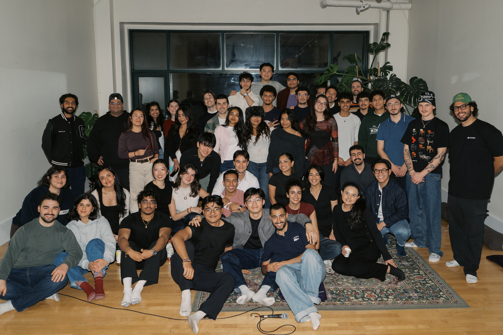
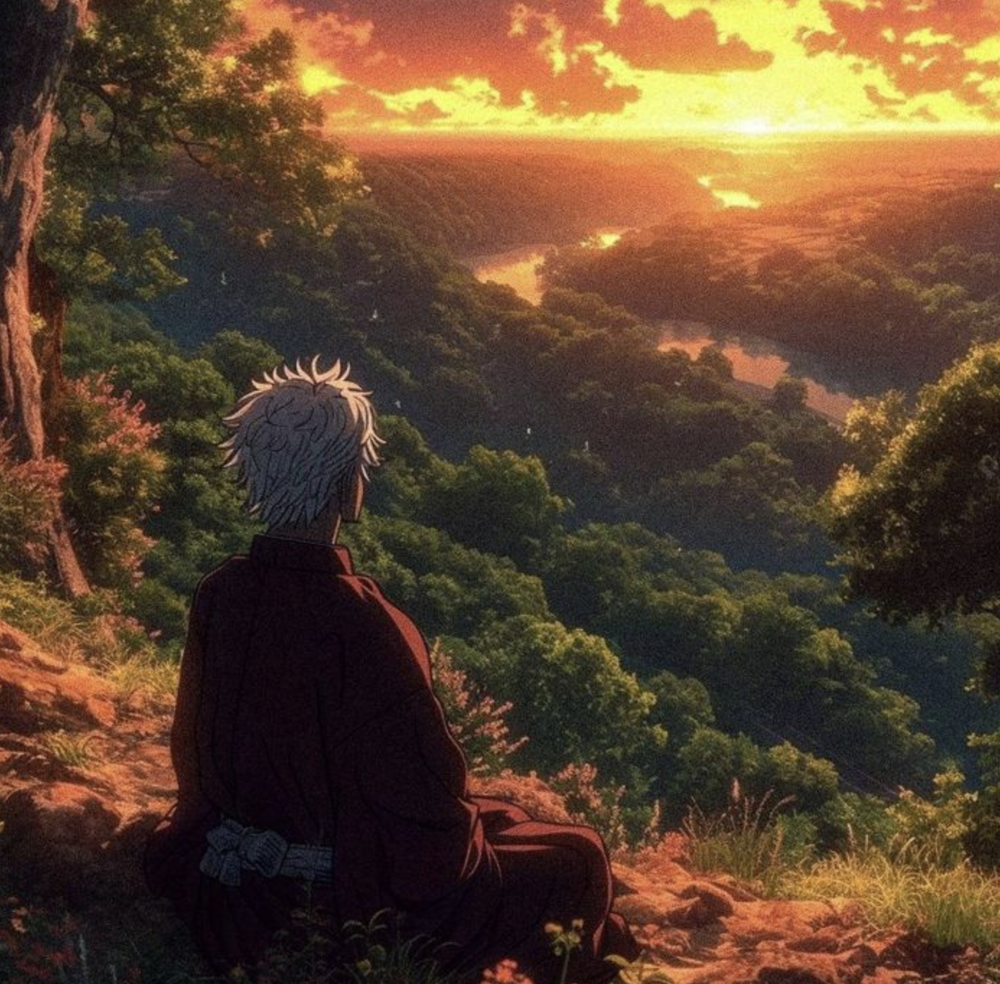

### what's been happening

This past quarter has been crazy, to say the least. I've had the highest of highs and the lowest of lows. But I think to sum up this quarter, it has been a sum of really interesting things in my life. I'm excited to share where my head is at ending 2025 and seeing where 2026 will bring me.

### travels

- I was very fortunate to find a flight deal to London in the UK and to achieve my dreams of watching Chelsea play live in a Premier League match at Stamford Bridge. This was genuinely one of the most fun experiences I've had in my life and I've dreamt of this moment since I was a kid.
- Seeing my parents and my sister were also highlights, and it was really nice to see them doing well. It's always nice to see family, especially since I live thousands of miles away from them.
- I also got to train BJJ with my cousin, met Roger Gracie along the way and caught up with my high school best friend who's also a VC in the UK.

  

    
    <em class="photo-caption">dream come true at stamford bridge</em>
  

  

    
    <em class="photo-caption">met the goat roger gracie</em>
  

  

    
    <em class="photo-caption">found this gem in london</em>
  

### random updates & projects

Had such a fun time re-starting 555 again. We hosted two events, our Classic Demo Nights and a collab with Shopify for Design Engineering event. Super fun and looking forward to doing more next year. Also random picture with my gf's dog Milo (he's happy to see me it seems)

  

    
    <em class="photo-caption">me and milo</em>
  

  

    
    <em class="photo-caption">design engineering event with shopify</em>
  

  

    
    <em class="photo-caption">555 gang</em>
  

### career

This is probably my biggest announcement yet. After an incredible journey as an investor at Panache Ventures, I'll be moving on in the new year. Since joining the firm in February, I've had the privilege of working alongside one of the brightest and most inspiring teams I've ever met. Making this decision wasn't easy it was, without a doubt, the riskiest choice I've made so far. Venture Capital has been my world for the past few years, and I know I'll miss it deeply (don't worry, I'll be back!). But I'm genuinely excited to take on a new challenge that pushes me outside my comfort zone and helps me grow even more. Plus, I'm thrilled to be moving to Toronto, a city whose energy captivated me a year ago, and I just knew I had to call it home.

  

    
    <em class="photo-caption">onto the next chapter</em>
  

### what's next

I'm going to be wrapping up the next few weeks reflecting on the wins and the losses of 2025, but most importantly getting ready for the big move and to share what I'll be doing in 2026. See you everyone, thank you for everything.

If you're reading this and live in Toronto would love to grab a coffee with you in the new year!

