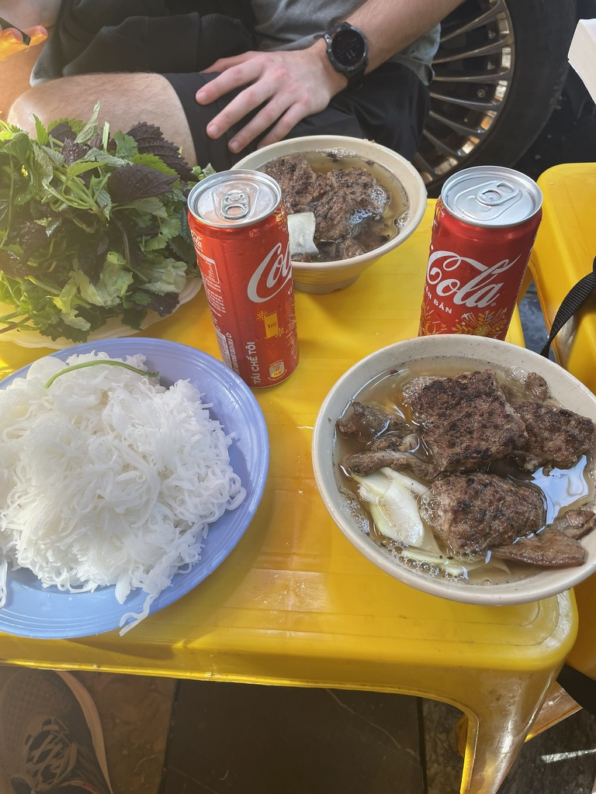
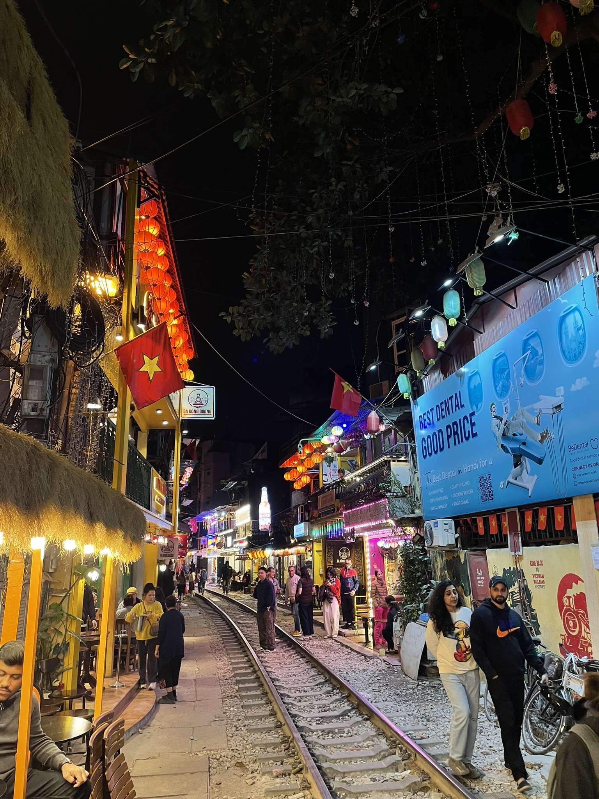
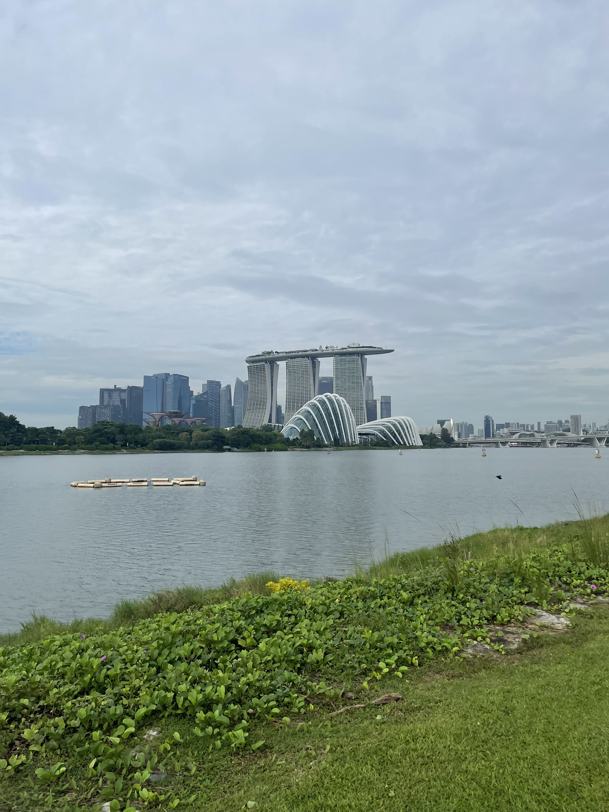
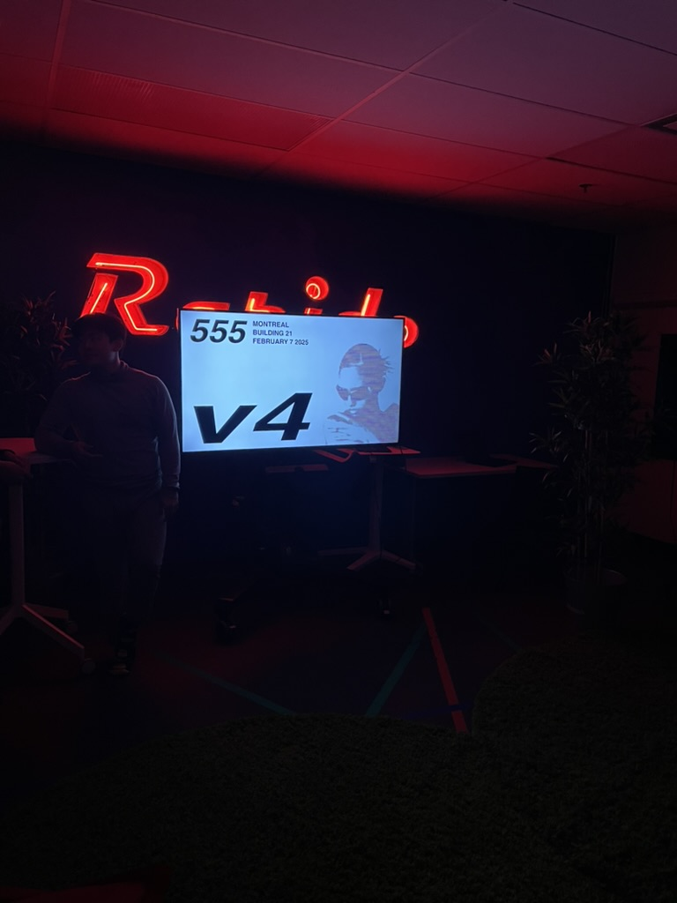
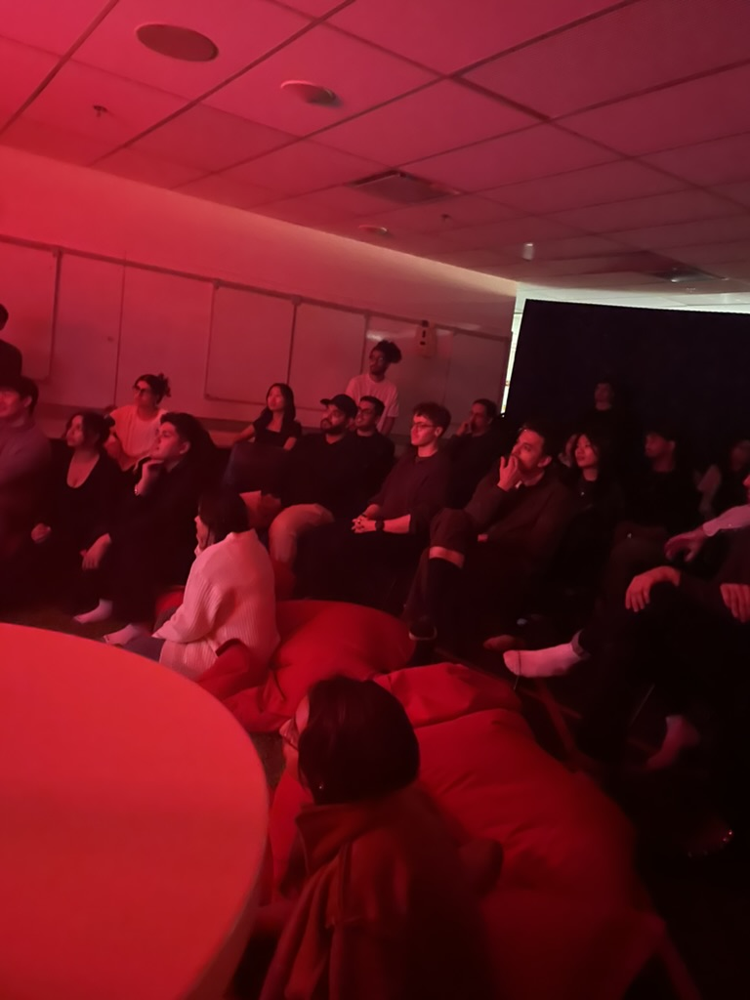
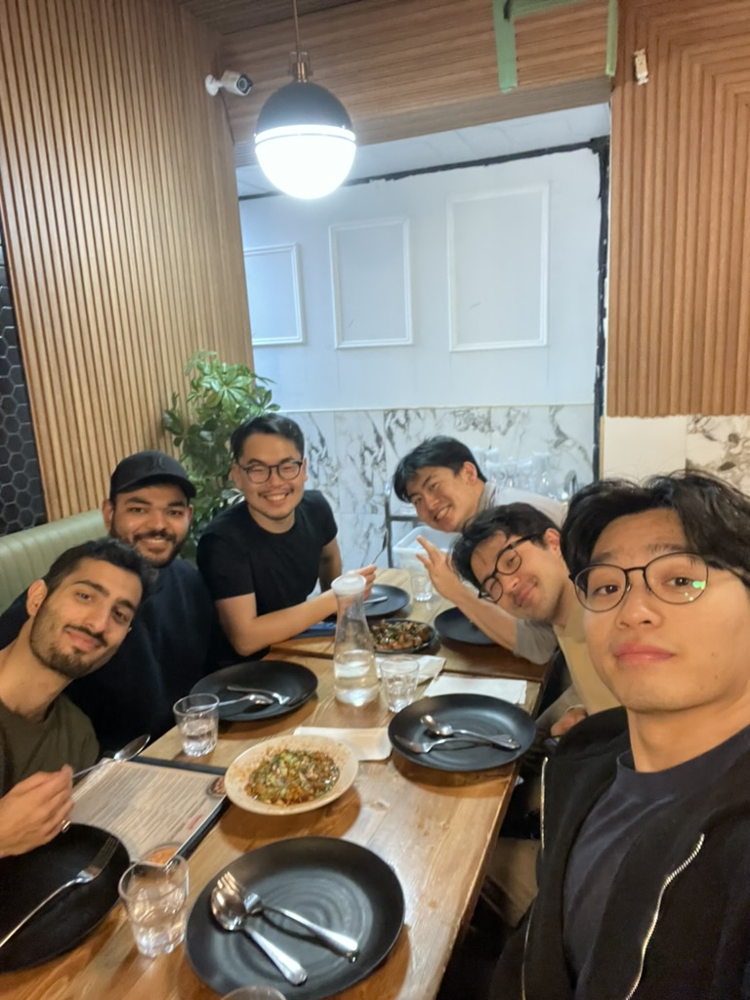
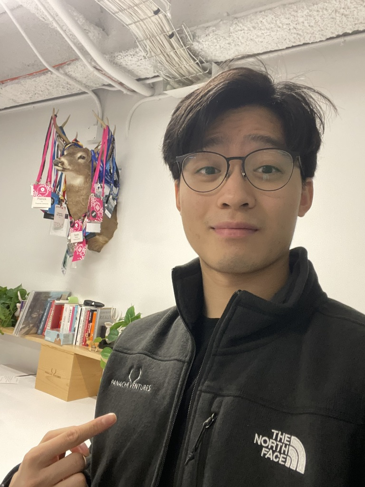
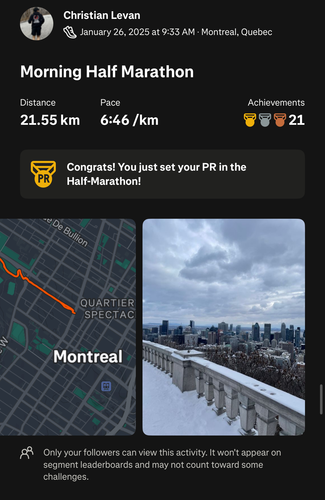
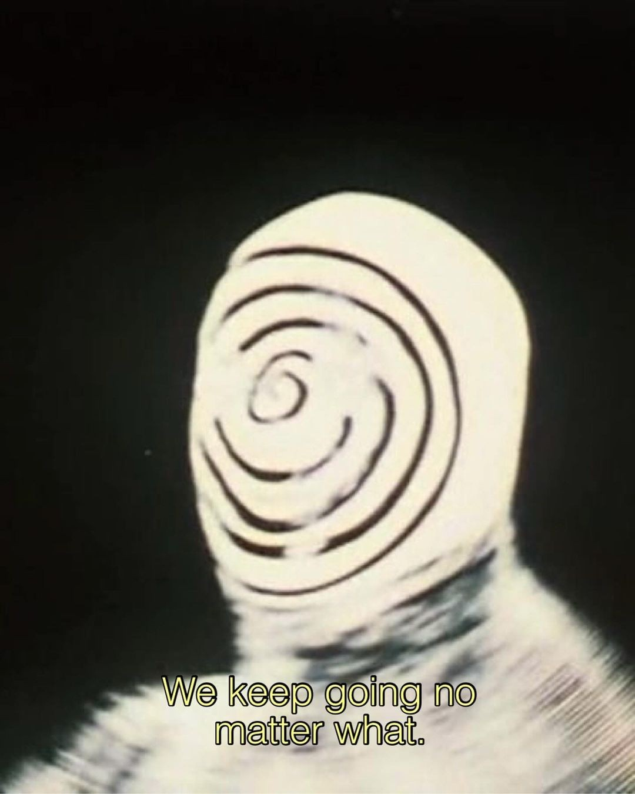

## what's been happening

- since i last wrote on my digital garden/blog it has a been quite a rollercoaster of emotions and events but here's a quick life update since the end of last year q4 24'!

### travels

- i went back home to visit my friends and family in singapore.
- main highlight was being able to run in positive degrees weather and just enjoy good food and company.
- my high school friends and i decided to go on a quick spontaneous trip to hanoi, vietnam.
- don't even need to explain how good the food was but here are a collection of photos from my short asia trip.
- good reset before going back to montreal.

  

    
    <em style="display: block; text-align: center;">Crazy Bun Cha</em>
  

  
  

    
    <em style="display: block; text-align: center;">Street of Hanoi</em>
  

  
  

    
    <em style="display: block; text-align: center;">Running in beautiful Singapore</em>
  

### random updates & projects

- i bought a new camera, a very cool dji osmo pocket 3, which i used a lot in dec to jan (have been slacking in feb).
- i found making tiktoks and vlogs were very fun but time consuming, documenting videos i believe are as important as documenting through other mediums like text. will resume this once school and work slows down in may.
- 555 demo nights have had 2 more iterations since last time, we had to find a new venue but vibes were immaculate as usual.
- blessed to have met these beauties.

  

    
    <em style="display: block; text-align: center;">red lights baby</em>
  

  
  

    
    <em style="display: block; text-align: center;">the lads chillin</em>
  

  
  

    
    <em style="display: block; text-align: center;">quick indian muck afterwards</em>
  

### career

- started last co-op as an associate product manager at altaml, a venture studio in toronto/calgary. working on ai/ml products in wealth management. challenging but great experience.
- signed full-time with panache ventures in montreal! excited to join their investment team post-grad and back canada's best startups.

  

    
    <em style="display: block; text-align: center;">new merch and at the office</em>
  

### fitness

- ran my first "un-official" half marathon attempt on a crazy uphill mountain in mount royal in montreal. felt good and can't wait to tackle the toronto half-marathon in may (when i stop procrastinating and book it lol).
- half took the pedal off the gas on jiu-jitsu recently as school and work together have been really hard to balance (technically i'm working 5 jobs at once rip).
- goal is to do an "un-official" marathon attempt at the end of the year and compete in jiu-jitsu again in the summer!

    

      
      <em style="display: block; text-align: center;">strava or didn't happen</em>
    

  

## what's next

- well, i need to graduate and pass my software design class (which i will) and wrap up my degree in may.
- i'm not going to lie it's going to be an insane 2 month sprint coming up for me but i will prevail.
- in june i return to singapore to finish 2 months of military service, a quick japan trip with my girlfriend and then we are back in montreal again.
- keep at it and see you all soon.

  

    
  

If you enjoyed this, you might like [[goals for the rest of q4' + photo dump]]
