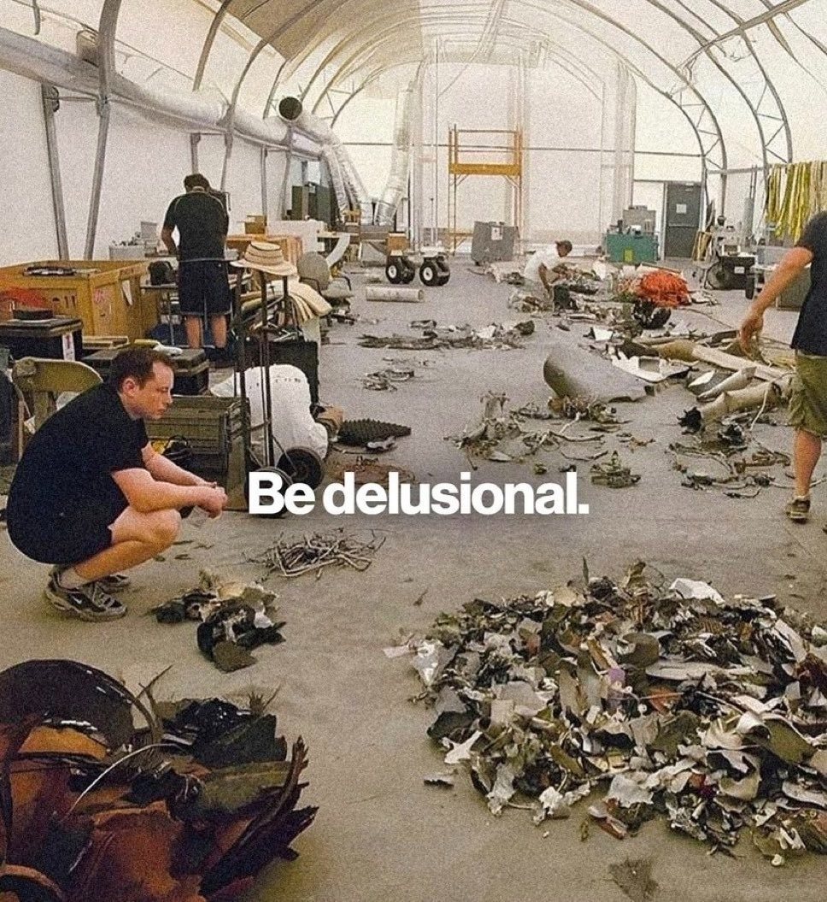

  

as i was jotting down my habits for the next month, i sat down to look at all the other habits i had successfully completed, failed, or stuck with. trying to wake up early. journaling. taking vitamins. reading x amount of pages in a day etc.

a lot of these have stuck, and a lot have fallen through. but as i reflected back and thought about one thing that kind of stuck but i never really tracked, it's my level of delusion.

delusion is waking up every day with the confident feeling that things will click without having physical or mental proof that it's going to work out. it's a fighting feeling in your body that you're so deeply believing in, so entrenched in what the outcome will be regardless of what happens, that failure doesn't even cross your mind.

i've had this weird feeling for a while. in high school, i wasn't getting the best grades, but i knew this wouldn't be the end of it. in college, i studied a non-technical degree but had this delusion that i could break into venture capital and tech with no connections or traditional background. i was deluded enough to believe i could break into the best vc fund in the country. and i did.

that same delusion recently caught up to me when i left my cushy vc job to join a startup with no prior experience doing growth or marketing. but delusional enough to know i'll be okay.

looking back, every major leap i've taken started with delusion. not discipline. not a morning routine. not a habit tracker. just an irrational, unexplainable belief that i could do it.

you can optimize every hour of your day. you can track every habit. but none of it matters without the one you can't measure.

so be delusional.

If you enjoyed this, you might like:

- [[i wish you ample doses of pain and suffering.]]
- [[why i left vc to go build.]]
